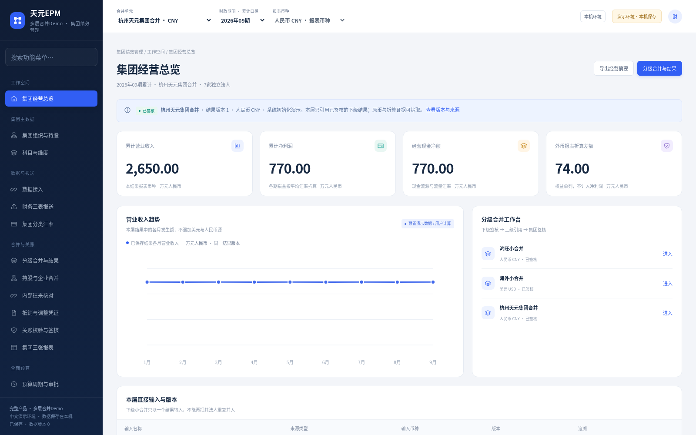

# 杭州天元宠物用品有限公司 · 多层合并中文 EPM Demo

**[下载新版 Windows EXE 运行包（约18.9 MB）](https://raw.githubusercontent.com/tongtrxtrx-sudo/AI-/epm-download-20261019/TianyuanEPM-Multilevel-Demo-Windows-x64.zip)**

完整解压 ZIP，双击 **天元EPM 多层合并Demo.exe**，会自动打开中文工作台。适用 Windows 10/11 64 位；包内附带运行环境，无需自行安装 Python、Docker、WSL 或虚拟机，不需要邮箱登录。

## 本次补齐的功能

- **分级合并**：鸿旺三家独立法人先形成鸿旺人民币小合并；海外法人先形成美元小合并；集团正式计算引用有效、已签核的下级结果版本。
- **真实范围与持股分开**：用户确认的鸿旺三份报表互不包含；管理合并树不会被误认为鸿旺直接持股树，真实持股按天元100%示例独立维护。
- **分层抵销与血缘**：内部销售在交易双方最低共同合并层处理，下级抵销只继承一次；投资权益抵销保留实际母子关系、源资本及投资账面依据。
- **美元财务报表折算**：资产负债使用期末汇率，逐月损益使用各月平均汇率，资本使用历史汇率，现金流使用流量汇率。外币报表折算差额和现金汇率变动影响分别列示。
- **版本与重算**：源报送、成员、抵销或适用汇率变化使依赖结果失效；重开后逐层重算、签核。保留原结果金额、下级版本、源版本、抵销及汇率证据。
- **中文可操作界面**：三表源字段编辑、完整CSV整批导入、成员配置、分类汇率、分层抵销、结果历史和钻取，以及集团人民币预算和经营分析。

所有演示配置和业务操作保存到本机 SQLite；再次启动会读取已保存数据。初始结果由同一正式计算与签核流程生成，并标记“系统初始化演示”。其他法人、人员、交易及金额为虚构样例。

## 按这个顺序演示

1. 在“分级合并与结果”查看鸿旺、海外和集团的初始结果及输入版本。
2. 选择“鸿旺小合并”，重新开启并填写原因。系统同步使依赖它的集团结果失效，保留历史结果。
3. 在“财务三表报送”编辑一个鸿旺法人源或下载完整CSV修改后导入；先保证源三表勾稽。
4. 回到鸿旺，计算并签核；再切回集团计算并签核，钻取新下级结果ID。
5. 在“集团分类汇率”发布期末率7.2→7.3的新版本，保持其他率不变；重新计算集团，对比净利润、折算差额和现金汇率影响。

具体输入、按钮、预期结果及排错见 [新版中文Word手册](https://raw.githubusercontent.com/tongtrxtrx-sudo/AI-/epm-download-20261019/multilevel-demo/EPM-Multilevel-Guide-CN.docx)；ZIP内也有Word及PDF。

## 可核对的初始示例

单位：境内及集团为人民币万元，海外原币为万美元，期间为2026年1—9月。

|项目|计算或预期|
|---|---|
|鸿旺小合并收入|1000＋300＋200－100＝1400|
|海外美元收入 / 净利润|100 / 20|
|集团收入|1400＋600－50＋100×7.0＝2650|
|集团净利润|770|
|集团期末资产 / 负债|2370 / 576|
|集团资本 / 留存收益 / 折算差额|950 / 770 / 74|
|集团现金流勾稽|期初950＋经营770＋筹资560＋现金汇率影响90＝期末2370|
|仅把期末率7.2改7.3|利润不变，折算差额86，现金汇率影响110|

## 新旧环境与验证

新版默认数据目录 **`%LOCALAPPDATA%\TianyuanEPMGroupDemo`**。它使用独立产品标识和端口，拒绝改写旧版或未知数据库；原来的 `TianyuanEPMDemo` 和 `SelfDevelopedEPM` 环境继续保留。请双击新EXE进入，使用它实际打开的地址。

关闭浏览器不会停止服务。演示结束通过“本机环境”安全退出；备份前先退出，再复制整个新版数据目录。

验证结果以 [新版独立验收报告](multilevel-demo/独立验收报告.md) 和包内证据为准。Windows原生EXE→包内Windows Python→Windows HTTP/SQLite在Wine实际运行；Wine不能替代Windows真机验收。EXE尚未签名。

本轮支持2026年、CNY/USD、全资全额合并。初始实际截至9期；10—12期未另报送时沿用9期累计。资本变动、分红、少数股东、复杂收购/商誉、其他币种、生产多用户隔离和外部ERP连接需另行研发验收。预算保持独立集团人民币口径，美元小合并不与人民币预算直接比较。

## 源码、文档与此前交付

新版ZIP包含完整前后端、计算和事务源码、字段/API契约、构建入口、CSV模板、中文Word/PDF手册和测试证据。无需安装开发工具即可运行包内EXE。

- [新版运行与演示手册](multilevel-demo/多层合并Demo安装与演示手册.md)
- [原中文Demo及三份系统/产品/用户文档（V1历史版）](HISTORY-Chinese-Demo-V1.md)
- [完整产品交互原型](https://raw.githubusercontent.com/tongtrxtrx-sudo/AI-/a68390de1e21e857f9db12a903f2718d37d79edc/EPM-Full-Prototype-CN.zip)
- [合并与分析交互原型（预算静态预留）](https://raw.githubusercontent.com/tongtrxtrx-sudo/AI-/a68390de1e21e857f9db12a903f2718d37d79edc/EPM-Consolidation-Analysis-Prototype-CN.zip)
- [既有中文Word/PRD研发需求材料](https://raw.githubusercontent.com/tongtrxtrx-sudo/AI-/a4b2b46120a20d0102abfba5f84e86f8aee9ecf9/EPM-Chinese-Word-Documents.zip)
- [此前Konsolidat运行平台交付记录](HISTORY-Konsolidat-Delivery.md)

本次仅更新已授权的 `epm-download-20261019` 下载分支，`master` 保持原样。根目录及ZIP内提供SHA256清单；公开下载核验结果见 [下载验证记录](multilevel-demo/public-download-verification.json)。
