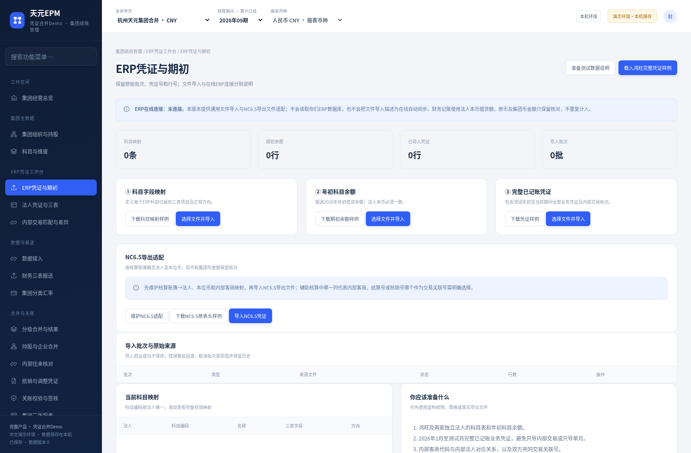

# 杭州天元宠物用品有限公司 · NC6.5凭证与集团EPM Demo

软件基线 **ERP-20261021** · 完整中文文档 **D1.0** · 发布日期2026-10-21。

**[下载新版Windows EXE运行包（约38.0MB）](https://raw.githubusercontent.com/tongtrxtrx-sudo/AI-/b06cb10451c81bb537acf4913d332943fcd00c5b/TianyuanEPM-ERP-Demo-Windows-x64.zip)** · **[下载全模块中文Word/PDF文档包](https://raw.githubusercontent.com/tongtrxtrx-sudo/AI-/b06cb10451c81bb537acf4913d332943fcd00c5b/TianyuanEPM-ERP-20261021-Full-Docs-CN-D1.0.zip)**

完整解压运行ZIP，双击 **天元EPM 凭证合并Demo.exe**。适用Windows 10/11 64位，附带运行环境，无需另行安装Python、Docker、WSL或虚拟机，不需要邮箱登录。请使用新EXE打开的地址，旧18480/Frappe页面不属于此新版Demo。不要只取EXE或在压缩包预览内运行。

## 本次可操作的流程

NC6.5导出CSV/XLSX→账簿与科目/内部客商映射→期初及已记账凭证入账→法人三表→内部销售与应收应付匹配→自动抵销草稿→负责人审批→鸿旺小合并签核→海外美元小合并→集团人民币合并。原预算、经营分析和治理模块保留，24项中文菜单。

只使用NC“本币借方金额/本币贷方金额”记法人账；交易币、集团/全局币及原48列保存核对，不重复入账。原金额为元两位，财务报表万元六位。**本版提供文件导入，企业NC在线接口尚未配置，界面明确显示“未连接”，不写回NC。**

差异保留双方凭证、原行与原因，不自动倒挤。核实后可补内部客商、关联号或现金流类别，留下前后标注；金额错误需核对ERP、更正后停用旧批次再导入。历史签核结果追溯其当时源、凭证与抵销快照；当前匹配差异清单在重扫时更新，需留存时及时导出。

## Excel模板与带截图导入指南（同软件基线补充）

**[下载6份Excel模板＋已填示例＋24页Word/PDF说明（约9.5MB）](https://raw.githubusercontent.com/tongtrxtrx-sudo/AI-/epm-download-20261019/TianyuanEPM-NC65-Excel-Import-Kit-D1.0.zip)**。你现有ERP-20261021无需更新EXE。

[单独下载Word图文说明](https://raw.githubusercontent.com/tongtrxtrx-sudo/AI-/epm-download-20261019/excel-import-kit/EPM-NC65-Excel-Import-Guide-CN.docx) · [单独下载PDF](https://raw.githubusercontent.com/tongtrxtrx-sudo/AI-/epm-download-20261019/excel-import-kit/EPM-NC65-Excel-Import-Guide-CN.pdf) · [查看6模板分别在哪导入](excel-import-kit/README.md)。四种表可直接导入；NC适配与现金分类两种为页面照填准备表，没有独立上传入口。说明含16张最终文件真实上传、生成与合并截图。

## 第一次怎么做鸿旺小合并

先看 **[首次测试操作卡](erp-demo/鸿旺小合并_首次测试操作卡.md)**。

1. 在“ERP凭证与期初”载入完整虚构样例，确认替换范围；已有真实测试数据先备份。
2. “法人凭证与三表”生成全部已导入法人。
3. 选择“鸿旺小合并”，扫描本层内部交易，准确项生成草稿，财务负责人审批。
4. 计算并签核鸿旺；再签核海外美元小合并，匹配及审批集团本层抵销，计算并签核集团。

鸿旺三家为独立法人且报表不重叠：鸿旺单体、鸿旺猫爬架生产事业部、杭州鸿旺宠物用品有限公司电子工厂；真实持股维护为天元100%，管理合并树不表示鸿旺持有另两家。

|核对项目（2026年1—9月，人民币万元）|预期|
|---|---:|
|鸿旺收入 / 净利 / 资产|1400 / 450 / 650|
|集团收入 / 净利 / 资产|2650 / 770 / 2370|
|集团累计折算差额 / 现金汇率影响|74 / 90|

运行包内“示例数据_NC65”另提供直接文件案例：84条映射、14行期初、NC48列共48行分录；鸿旺80已结算+20未结算及20往来余额，共3项匹配，集团1项。内置396行案例为鸿旺18项、集团9项，前者内部销售与往来各合计100万元、后者销售合计50万元；不同案例不要混导或混用计数。详细输入与恢复见产品说明书及用户手册第六章。

## 四份全模块中文Word与PDF

|文档|Word|PDF|
|---|---|---|
|PRD研发需求规格说明书（含字段字典）|[下载Word](https://raw.githubusercontent.com/tongtrxtrx-sudo/AI-/b06cb10451c81bb537acf4913d332943fcd00c5b/erp-docs/EPM-ERP-PRD-CN.docx)|[查看PDF](https://raw.githubusercontent.com/tongtrxtrx-sudo/AI-/b06cb10451c81bb537acf4913d332943fcd00c5b/erp-docs/EPM-ERP-PRD-CN.pdf)|
|系统研发与交互说明书|[下载Word](https://raw.githubusercontent.com/tongtrxtrx-sudo/AI-/b06cb10451c81bb537acf4913d332943fcd00c5b/erp-docs/EPM-ERP-System-CN.docx)|[查看PDF](https://raw.githubusercontent.com/tongtrxtrx-sudo/AI-/b06cb10451c81bb537acf4913d332943fcd00c5b/erp-docs/EPM-ERP-System-CN.pdf)|
|产品说明书（演示案例）|[下载Word](https://raw.githubusercontent.com/tongtrxtrx-sudo/AI-/b06cb10451c81bb537acf4913d332943fcd00c5b/erp-docs/EPM-ERP-Product-CN.docx)|[查看PDF](https://raw.githubusercontent.com/tongtrxtrx-sudo/AI-/b06cb10451c81bb537acf4913d332943fcd00c5b/erp-docs/EPM-ERP-Product-CN.pdf)|
|用户操作手册|[下载Word](https://raw.githubusercontent.com/tongtrxtrx-sudo/AI-/b06cb10451c81bb537acf4913d332943fcd00c5b/erp-docs/EPM-ERP-User-Manual-CN.docx)|[查看PDF](https://raw.githubusercontent.com/tongtrxtrx-sudo/AI-/b06cb10451c81bb537acf4913d332943fcd00c5b/erp-docs/EPM-ERP-User-Manual-CN.pdf)|

每册均覆盖全部24模块，PRD含NC48列、映射/期初/分录/三表/抵销/追溯字段、状态、接口及验收；独立文档包含可编辑原稿、截图、示例文件、字段契约及变更记录。每次升级完整重发四件套的长期约定见[交付标准](erp-demo/DELIVERY-STANDARD.md)。

## 保存、退出、验证与范围

新数据目录为`%LOCALAPPDATA%\TianyuanEPMVoucherDemo`；旧版账套保留，不自动迁入，不覆盖旧/未知数据库。关闭浏览器不会停止服务；通过“本机环境”安全退出，备份前停止并复制整个数据目录。

[独立验收报告](erp-demo/NC65凭证合并独立验收报告.md)记录当前源码4套37组真实HTTP/Chromium回归；产品另有14组真实案例。原生EXE→包内Windows Python→HTTP/SQLite在Wine兼容环境重新通过20项，**尚未代替实体Windows真机验收**，EXE未签名。四Word四PDF另经语义核对、真实XML/CRC和排版检查；[版本和校验](erp-demo/交付版本与校验.json)记录实际摘要。

本版为2026、100%全资全额、CNY/USD普通主体的本机研发Demo。自动匹配支持内部销售/成本及应收/应付；复杂存货未实现利润、商誉、少数股东、复杂权益事件及生产多用户身份隔离等需后续研发。预算为独立集团人民币口径，不把业务预算自动驱动财务三表宣传为已完成。

## 历史交付

- [此前多层合并Demo（ML-20261020）](HISTORY-Multilevel-Demo-ML-20261020.md)
- [此前中文Demo及文档](HISTORY-Chinese-Demo-V1.md)
- [原型及Konsolidat历史交付](HISTORY-Konsolidat-Delivery.md)

只更新用户已授权的`epm-download-20261019`下载分支；`master`保持原样。公开HTTPS已实际下载2个ZIP、4份Word、4份PDF，10项全部逐字节及SHA256核对通过，ZIP/Word结构完整。见[公开下载验证记录](erp-demo/public-download-verification.json)；下载链接固定至实际制品提交，后续升级不会改变本版文件。
