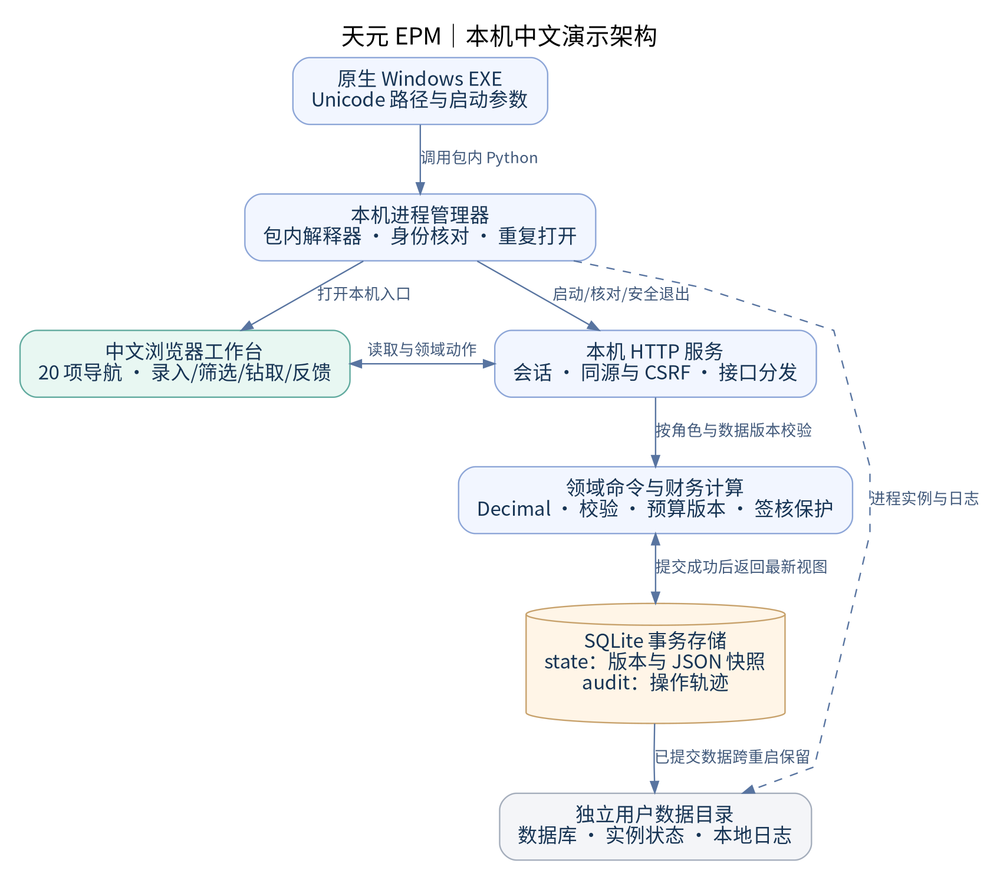
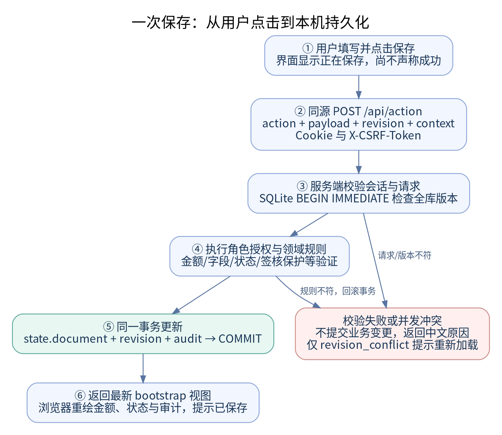

# 天元 EPM 系统研发与交互说明书

公司：杭州天元宠物用品有限公司  
文档版本：V1.0  
编制日期：2026 年 10 月 20 日  
适用软件：20261020-cn-demo1 中文本机演示版  
读者：技术负责人、产品经理、前后端开发、财务模型开发、测试与交付人员

## 文档控制与阅读约定

本说明书描述已经交付的程序怎样构成、怎样响应操作、怎样保存数据，以及开发人员怎样继续研发和构建。所述“已实现”以本轮运行源码、冻结构建和独立验收为依据；“生产扩展建议”单独说明，不代表当前 Demo 已具备对应能力。

本轮应用依据用户确认的完整产品原型重新实现，提供中文界面、业务规则、SQLite 持久化和 Windows 便携入口。此前 Konsolidat／Konsol 的研究及运行材料用于理解 EPM 业务和制定研发目标；本轮运行应用采用独立的前端、领域模型与本机服务，不依赖旧 Frappe／QEMU 平台，也不自动读取旧账套。研发人员应分别维护“原项目研究材料”“当前演示实现”和“拟研发的生产产品”三类基线。

主公司名称由用户指定；子公司、责任人、交易和财务数字均为虚构样例。文中的金额默认以人民币万元为单位。技术字段、路径、币种代码和接口动作名保留实际源码名称，普通业务界面使用简体中文。

|基线项目|准确内容|
|---|---|
|运行包|TianyuanEPMDemo-Windows-x64.zip|
|运行包字节数|16,473,129|
|运行包 SHA-256|55d6ebe5318055dce47aa03638dff357f2ec46b86e61240b0f3d1541383f5519|
|浏览器最终 HTML SHA-256|6130c8117ed84a29a45431a4565f4af60c75ee7181380d77ef98b1074970061f|
|软件发布提交|a68390de1e21e857f9db12a903f2718d37d79edc|
|Windows 目标|Windows 10／11，x64|
|包内运行时|Windows Python 3.12.10，SQLite 3.49.1|
|开发端运行依赖|后端和前端构建使用 Python 标准库；浏览器执行原生 JavaScript|

## 1. 系统定位与研发思路

### 1.1 要解决的问题

系统围绕集团财务管理的三个连续问题组织功能：各法人怎样报送一致口径的数据，集团怎样形成调整后的合并报表，以及管理层怎样比较预算与实际。界面将主数据、报送、合并关账、预算和经营分析放在同一导航体系内，使用户可以从经营指标继续追到法人报送、合并凭证和操作记录。

本轮首先实现可重复演示的闭环：录入或导入数据，服务器校验并保存，重新计算页面投影，再执行审批或签核。它解决了纯 HTML 原型刷新即重置、按钮只展示说明以及界面与交付软件不一致的问题。Demo 的合并及预算模型仍有明确简化，不能直接用于公司的正式财务报账和监管申报。

### 1.2 本轮采用的分层方法

|层次|承担职责|设计理由|
|---|---|---|
|产品交互层|统一导航、上下文筛选、表单、图表、钻取、中文反馈|沿用完整原型的信息结构，减少从原型到程序的认知差异|
|HTTP 与会话层|接收请求、校验来源和会话、控制静态目录、返回 JSON|将页面表现与可信业务规则分开|
|业务动作层|预算状态、导入、凭证、签核、角色和输入约束|客户端只能申请动作，不能直接替换服务器业务状态|
|财务计算层|源余额、已审批分录、三表、币种展示及勾稽|把金额计算放在可独立测试的纯计算模块|
|存储层|单库事务、版本号、JSON 业务快照、审计|在单机 Demo 中减少部署依赖，同时保留持久性和回滚|
|Windows 交付层|Unicode 原生入口、包内解释器、进程复用、打开浏览器|实现完整解压后双击运行，不要求用户安装开发环境|

### 1.3 研发顺序

实际研发以“原型页面—业务动作—后端契约—持久化—集成验收”为主线。先明确每个页面读取的字段与按钮提交的动作，再统一 API 字段，随后实现可在事务中执行的领域命令。界面只在服务器确认成功后更新为新状态，财务变动由后端计算，最后通过真实 HTTP、浏览器和 Windows 启动链路验证。

继续研发时也应保持这一顺序。增加一个业务按钮，需要同时说明：输入字段是什么，当前角色能否执行，前置状态是什么，保存到哪里，会影响哪些报表和校验，失败时用户看到什么，以及怎样验证重启后仍然正确。只新增弹窗或只新增数据库字段，都不足以构成完整功能。

## 2. 总体架构与源码定位



### 2.1 运行时结构

用户双击原生 EXE 后，由包内 Python 启动管理器拉起本机 HTTP 服务。HTTP 服务提供前端 HTML，并读写用户目录中的 SQLite 数据库。浏览器、业务服务与数据库均运行在用户电脑上；网络绑定为 127.0.0.1，端口默认由操作系统分配。首次启动初始化虚构演示账套，以后启动读取已经保存的业务快照。

浏览器不直接访问 SQLite，也不直接运行原生 EXE 的命令。浏览器通过受会话保护的 HTTP 接口读取和提交动作；“打开数据目录”只请求服务打开它已知的固定数据路径，“安全退出”请求服务停止。旧平台的固定端口 18480 不用于识别此 Demo。

### 2.2 源码索引

|源码位置|主要内容|修改时应联动检查|
|---|---|---|
|frontend/src/shell.html|页面外壳、全局导航容器与顶部控件|元素标识与 app.js 事件绑定|
|frontend/src/style.css|布局、卡片、表格、弹窗、图表及响应式样式|1920、1366 等桌面宽度和窄屏溢出|
|frontend/src/app.js|20 个页面、路由、API 调用、表单、钻取及 CSV 导出|动作字段、后端返回值、中文提示和用户值转义|
|frontend-build.py|把外壳、CSS、配置及脚本内嵌为最终 HTML|构建后 index.html 的实际字节|
|backend/server.py|本机 HTTP、会话、CSRF、静态文件及运行控制|来源校验、接口状态码、日志中不输出凭据|
|backend/engine.py|种子账套、领域动作、状态机、CSV 导入、页面投影|金额和权限、事务回滚、期间隔离|
|backend/finance.py|Decimal 校验、法人源数据、凭证影响、三表及勾稽|财务基准、现金流桥接、币种和期间口径|
|backend/store.py|SQLite 结构、读取、BEGIN IMMEDIATE、版本冲突和审计|并发版本、业务与审计同事务提交|
|backend/API-CONTRACT.md|当前接口及动作的字段契约|修改接口时同步更新本说明及验收|
|backend/examples|空白 CSV 模板及平衡示例|表头、法人科目编码、期间和余额口径|
|windows/launcher.c|Unicode 原生入口、参数编码、启动包内解释器|中文路径、空格、命令参数及错误反馈|
|windows/app/demo_launcher.py|数据路径、互斥、进程身份、启动、复用和退出|PID 复用、启动竞态、私有实例文件|
|build_windows.py|编译 EXE，装配运行树、源码、许可和文档|输入输出路径分离及构建工具参数|
|package_windows.py|ZIP、逐文件 SHA-256 和私有数据拒收|ZIP 完整性、实际交付字节和清单|
|acceptance|独立 HTTP／浏览器测试与冻结证据|不以原型静态加载替代实际服务验收|

### 2.3 运行目录与源码目录

运行包中 app、backend、frontend 为实际执行内容，其中 frontend/index.html 是构建结果；source 目录另附可重建的源码树。源码工程中浏览器构建结果位于 frontend/dist/index.html。服务启动器显式传入实际静态根，因此开发路径与运行路径可以不同。

程序目录与数据目录必须分开。默认业务数据路径为 `%LOCALAPPDATA%\TianyuanEPMDemo`，其中有 epm-demo.sqlite3、运行锁、当前实例文件和 logs。重新解压程序不等于初始化或删除数据库。不要把用户数据库放进 source 或运行 ZIP 中。

## 3. 启动、会话与退出生命周期

### 3.1 从 EXE 到可访问页面

1. 原生入口取得自身目录，定位同目录的 python/pythonw.exe；终端参数模式使用 python/python.exe。它不从系统 PATH 搜索 Python，不通过 shell 拼接运行命令。
2. 以 `-I -X utf8` 参数启动 app/demo_launcher.py。隔离模式减少用户环境对包内解释器的影响，UTF-8 配合 Unicode Windows API 处理中文和空格路径。
3. 管理器确定用户数据目录，建立 logs，获取 launcher.lock 的进程锁。锁用于协调同一数据目录的重复启动，不用于财务记录锁。
4. 若已有实例，管理器同时校验进程创建时间、健康接口产品名及随机 instanceId；只有身份一致时才复用。不能仅凭 PID 或端口判断“这是自己的服务”。
5. 若无可复用实例，启动 backend/server.py，传入数据目录、端口和静态目录。数据库没有业务快照时才生成种子账套。
6. 服务绑定本机地址，输出只给启动管理器使用的 ready JSON。管理器校验地址、端口、进程创建时间及健康身份，确认有效后才原子写入 instance.json。
7. 管理器在后台线程打开浏览器，地址片段含当前进程启动凭据；浏览器交换本机会话后删除该片段，进入集团经营总览。

### 3.2 凭据、会话与角色

|对象|存放位置|生命周期与用途|
|---|---|---|
|启动 token|服务内存、当前用户的私有 instance.json|当前服务进程有效；用于交换本机会话及启动器安全停止|
|instanceId|服务内存与私有实例文件|随机服务身份，配合 PID 创建时间验证复用对象|
|会话 cookie|浏览器 HttpOnly、SameSite=Strict cookie|服务器内存会话；进程退出后不可继续使用|
|csrfToken|会话内存与浏览器运行状态|写请求必须带 X-CSRF-Token；不是业务数据库字段|
|sessionRole|服务器会话对象|默认集团财务负责人；可切换为法人会计、审计只读|
|业务 revision|SQLite state 表|跨重启保留，表示全库业务快照版本|

启动 token 是当前本机环境的访问凭据，不是 Gmail、Google OAuth 或企业账号密码。它放在 URL fragment 中，不作为 HTTP 查询字符串发送；页面交换会话后用 history.replaceState 清除。源码、公开截图和验收报告只使用占位值，不应包含实际 token、cookie 或 instance.json。

角色切换接口改变当前演示会话中的角色，不创建真实用户，也不构成企业身份认证。持有本机启动凭据的人能够切换演示角色，因此生产级职责分离不能直接依赖这套演示登录机制。

### 3.3 重复启动和安全退出

再次双击 EXE 时，同一数据目录的启动管理器优先复用已验证实例并打开浏览器。关闭浏览器仅关闭用户界面，后台服务和数据仍在。页面“本机环境—安全退出”通过会话、CSRF 和同源校验提交停止请求；管理器等待服务正常结束并清理属于当前 instanceId 的实例记录。

终端停止模式使用本机实例 token 调用 /api/shutdown，随后核对进程创建身份是否消失。它不会因退出超时而任意终止其他 PID。服务重新启动后会生成新的本机访问凭据，同时读取相同 SQLite 文件；业务 revision 和审计记录仍保留。

## 4. 页面、路由与业务交互

### 4.1 20 项导航与职责

|路由|中文页面|主要读取与实际交互|
|---|---|---|
|overview|集团经营总览|读取当前期三表指标、趋势、预算比较和关账进度；进入关联模块|
|org|集团组织与持股|查看法人范围；保存法人标识、编码、名称、责任人与币种|
|master|科目与维度|查看和维护集团科目与内置报表字段映射；导出科目|
|sources|数据接入|说明当前 CSV 方式、模板和预留的外部系统连接边界|
|submissions|试算平衡报送|选文件或粘贴 CSV、整批导入、查看批次、确认报送|
|rates|集团汇率|维护美元展示汇率并刷新币种展示|
|ownership|持股与企业合并|读取示例持股比例、方法和边界说明|
|intercompany|内部往来核对|查看演示交易关系，保存核对说明；不会自动生成抵销分录|
|journals|抵销与调整凭证|保存借贷平衡草稿、查看分录、由负责人审批|
|closing|关账校验与签核|报送、说明、校验、签核及重新开启的状态闭环|
|statements|集团三张报表|切换利润、资产负债、现金流；钻取及导出当前报表|
|budget-cycle|预算周期与审批|查看版本、提交、审批、锁定和复制|
|budget-sheet|预算编制与分摊|四层目标、量价驱动、分摊方案与业务预算明细保存|
|budget-adjust|预算调整与滚动预测|记录调整快照，批准后生成独立版本|
|budget-version|版本与多情景|查看、比较、复制和切换完整预算快照|
|analysis|经营差异与钻取|当前预算与实际的收入、成本、费用和财税差异|
|reports|管理报表中心|关联三表、关账、报送和预算等实际页面|
|permissions|组织权限|显示演示权限矩阵，并申请会话角色切换|
|audit|审计轨迹|读取实际保存动作、中文动作标签与事务版本|
|settings|系统配置|维护公司名称；展示固定 2026 年度及简体中文；打开本机工具|

### 4.2 路由和上下文的区别

路由控制“显示哪一页”，上下文控制“按哪个范围和期间读取数据”。页面上下文包括 group、month、currency、entity。group 取 group 或 mfg，month 为 1—12，currency 为 CNY 或 USD，entity 为 all 或已存在法人标识。固定会计年度为 2026，不能通过改年度标签创建新账套。

切换期间、集团、币种或法人时，前端重新调用 bootstrap；切换预算类型等纯展示选项时，可以只重新渲染已取得的数据。切换集团会清理法人钻取范围。经营分析和三表可以保留法人筛选，转到其他业务页时会按程序规则回到整体口径，避免把局部分析筛选误当集团业务提交对象。

当前预算的活跃版本保存于业务快照中，切换版本使用 budget_switch 动作并持久化。它不是生产多用户应用中的“每个用户独立偏好”。新增多人版本协作时，应重新设计活跃版本与编辑范围。

### 4.3 一次正常读取

页面初始化时执行 start：发现启动 token 后先 POST /api/session，收到会话 cookie，再清除地址中的凭据；随后 GET /api/bootstrap，并把返回对象写入浏览器运行状态。渲染函数依据当前路由产生页面内容，统一更新公司名、期间、金额单位、角色和“已保存·数据版本”标识。

bootstrap 不是静态示例 JSON。它从 SQLite 读取最新状态和最近审计记录，解析上下文，调用财务计算模块，产生当前期 statement、checks、法人实际和月度实际投影，再连同预算及基础数据返回。

### 4.4 一次保存、反馈与失败处理



以修改基础层销售预算为例，用户输入金额后，前端提交 budget_layer_save、layer=0、amount 和当前 revision。服务器先校验会话、来源和 CSRF，在事务中核对 revision，并按当前会话角色检查权限、预算状态及金额精度，更新当前版本，再写入审计和新 revision。成功返回完整 bootstrap，前端才关闭弹窗、刷新页面并显示“已保存到本机数据库”。

前端没有先修改显示金额再假定保存成功。保存期间使用 busy 标识防止同页重复提交。若出现 revision_conflict，前端读取最新状态，提示用户核对后重试，不自动覆盖其他页面修改。预算已锁定、期间已签核等错误可能同样使用 HTTP 409，但应显示各自中文业务原因，不能统称“其他人修改了数据”。

|HTTP 状态或错误码|代表含义|界面应采取的处理|
|---|---|---|
|200|动作完成或读取成功|采用服务器返回状态，更新已保存版本|
|400 validation|字段、金额、借贷或业务输入不正确|保留纠正机会，显示中文原因|
|401 unauthorized|本机会话不存在或失效|提示从 EXE 重新打开，不要求输入邮箱|
|403 forbidden|当前演示角色无权执行|提示所需角色；不得在浏览器绕过后端限制|
|403 csrf／invalid_origin|安全校验或来源无效|重新打开或刷新合法会话，不绕过校验|
|409 revision_conflict|提交的业务快照版本过期|加载最新数据，核对后重新提交|
|409 budget_locked／period_locked|预算状态或期间保护不允许写入|复制版本、调整或由负责人重新开启|
|409 incomplete_workflow／stale_checks|签核前置不完整或校验过期|补齐步骤或重新运行校验|
|413／415|正文过大或不是 JSON|按模板和允许大小重新提交|
|500 internal|程序或运行环境异常|显示中文概述，研发在本地日志定位具体堆栈|

## 5. HTTP 接口与字段契约

### 5.1 基础接口

|方法与路径|输入／认证|主要响应|
|---|---|---|
|GET /api/health|本机 Host 校验；不返回凭据|ready、instanceId、product|
|POST /api/session|同源；JSON token|csrfToken、sessionRole 和 HttpOnly cookie|
|GET /api/bootstrap|有效 cookie；四项上下文查询参数|revision、业务源数据、计算投影、当前权限|
|POST /api/action|cookie、CSRF、Origin；动作信封|成功后的完整 bootstrap 或中文错误|
|GET /api/runtime|有效 cookie|dataDir、logDir、platform|
|POST /api/open-data-dir|cookie、CSRF、Origin；空 JSON|opened、固定 dataDir、中文 message|
|POST /api/shutdown|页面会话及 CSRF，或启动器专属头|安全退出已受理；随后服务停止|

静态文件只允许从配置的静态根下读取，路径解析后必须仍在该根内。HTTP 服务检查 Host 与允许的 Origin，未提供跨源访问许可。请求 JSON 上限为 2,100,000 字节；浏览器文件输入也限制 2 MiB。达到文件上限时 JSON 包装仍可能超过正文上限，研发接口联调应留出封装空间。

### 5.2 动作请求示例

```json
{
  "action": "budget_layer_save",
  "payload": {"layer": 0, "amount": "16123.45"},
  "revision": 12,
  "context": {"group": "group", "month": 9, "currency": "CNY", "entity": "all"}
}
```

示例 revision=12 仅表示格式，实际必须使用最近一次 bootstrap 返回值。请求头为 Content-Type: application/json、X-CSRF-Token: <当前会话占位值> 和合法同源 Origin，cookie 由浏览器自动附带。不能把示例中的版本号或凭据字符串硬编码到产品。

错误响应格式为 `{error:{code,message},message}`。解析时先读取 error.code 决定是否属于版本冲突，再展示 message。客户端不提交整个 state，也不以角色名字段伪造当前会话身份。

### 5.3 业务动作字段分类

|动作|主要 payload|服务器约束或结果|
|---|---|---|
|role_switch|role|三种演示角色；只改会话，不增加业务 revision 或审计行|
|entity_save|id、code、name、short、owner、currency|负责人；法人标识格式与编码唯一；本位币为人民币|
|account_save|code、name、type、field、normalSide|负责人；类别、内置字段和借贷方向均受限|
|rate_save|currency、rate|负责人；仅 USD；大于 0，最多 6 位小数，不超过 1,000,000|
|tb_import|csv、sourceName|法人及科目存在、期间一致、整套借贷平衡；整批提交|
|journal_create|title、kind、reason、lines、cashflowCategory|平衡分录草稿；含现金变动须选择类别|
|journal_approve|id|负责人；草稿审批后才纳入报表，并使当月旧校验失效|
|submission_confirm|空对象|财务勾稽通过后确认当前月报送|
|ic_confirm|reason|核对说明必填；保存确认标识|
|commentary_save|text|经营说明必填，最多 3,000 字|
|checks_run|空对象|重算真实财务勾稽并记录源指纹|
|signoff|空对象|负责人；四项前置完成、指纹仍有效且勾稽通过|
|period_reopen|reason|负责人；原因必填，使签核与旧确认失效|
|settings_save|companyName、fiscalYear|负责人；公司名可改，会计年度必须为 2026|

|预算动作|主要 payload|结果|
|---|---|---|
|budget_layer_save|layer 0—3、amount|修改当前草稿四层之一|
|budget_spread|spread=even／seasonal|保存全年分摊方案|
|budget_driver|volume、price|数量为非负整数；量价目标调整最后一层|
|budget_plan_save|type、rows|七类业务明细；每行金额等于数量×单价|
|budget_submit|空对象|编制中转审核中|
|budget_approve|空对象|负责人将审核中转已审批|
|budget_lock|空对象|负责人将已审批转已锁定|
|budget_copy|name、scenario|完整快照复制为独立编制中版本，并切换|
|budget_switch|name|恢复已保存版本的层次、状态、分摊和业务明细|
|budget_adjust_create|layer、delta、reason|创建带原版快照的待审批调整|
|budget_adjust_approve|id|负责人批准并生成独立已审批版本|
|budget_adjust_reject|id、reason|负责人退回该调整，原预算不因此变更|

### 5.4 bootstrap 关键字段

|字段|类型／含义|消费原则|
|---|---|---|
|revision|整数，全库业务版本|所有持久化动作带回；不能按页面自行加一|
|companyName、settings|公司及固定年度、语言、单位|用于抬头与上下文；不可另保留失效硬编码|
|sessionRole、capabilities|当前服务器会话角色与允许能力|前端可据此提示，后端仍独立授权|
|entities、accounts、rates|法人、科目映射和展示汇率|基础数据与报表源值分开识别|
|trialBalances|导入批次、源文件名及行数据|用于报送追踪；期间覆盖保存在数据库 JSON 的 periodOverrides 中，不作为 bootstrap 顶层字段返回|
|journals|草稿／已审批凭证及分录影响|未经审批不得算入实际结果|
|budget|活跃完整预算及历史版本、调整|版本不能仅保存年度合计而丢失明细|
|period、periods|当前范围月份和全部关账状态|判断签核要使用服务器状态及有效指纹|
|statement、report|当前上下文的三表和指标投影|返回币种已按请求换算，不再重复除汇率|
|entityActuals、monthlyActuals|法人独立损益、累计差分后的月度收入|前端按范围展示；不能与年度预算源值混同|
|checks|当前集团／月份整体人民币关账校验|不随法人钻取变成局部签核依据|
|activities|最近 200 条实际事务审计|界面动作名转换为中文；不当作完整数据库备份|

## 6. SQLite 数据模型与持久化

### 6.1 实际关系表

当前数据库采用“单条业务快照＋审计表”。没有独立的法人表、预算表、凭证明细表或报表事实表。下列为源码实际结构，正式产品可以据此做数据迁移设计，不能把建议的规范化表误称为当前实现。

|表与字段|类型和约束|含义|
|---|---|---|
|state.id|INTEGER PRIMARY KEY，CHECK id=1|单一业务快照记录|
|state.revision|INTEGER NOT NULL|乐观并发控制版本|
|state.document|TEXT NOT NULL|完整业务对象序列化后的 JSON|
|audit.id|INTEGER PRIMARY KEY AUTOINCREMENT|审计顺序号|
|audit.time|TEXT NOT NULL|服务器生成的带时区时间字符串|
|audit.role|TEXT NOT NULL|执行动作时的演示角色|
|audit.action|TEXT NOT NULL|动作技术标识|
|audit.detail|TEXT NOT NULL|服务器产生的中文业务描述|
|audit.revision|INTEGER NOT NULL|该审计对应的提交版本|

SQLite 连接使用 WAL 日志和 15 秒 busy_timeout。读请求取得快照和最近审计；写请求使用 BEGIN IMMEDIATE 获取写事务，核对 expected revision，反序列化业务状态，在内存副本上执行领域动作，写回 document 和递增 revision，并在同一事务写入审计。任一异常会 rollback，避免导入半批成功或业务已变而审计未生成。

### 6.2 document 中的业务结构

|JSON 节点|关键子字段|用途及保存粒度|
|---|---|---|
|settings|companyName、fiscalYear、language、unit|本机账套基础信息|
|entities|id、code、name、short、owner、currency、损益、opening、closing、cashflow|法人档案与种子源余额|
|accounts|code、name、type、field、normalSide|集团科目至内置报表字段的映射|
|rates|CNY、USD 对应展示汇率|源金额为人民币，展示币转换单独执行|
|journals|id、title、status、lines、effects、month、group|组内合并调整及审批状态|
|trialBalances|id、month、rowCount、sourceName、rows、importedAt|保留批次及已解析源行|
|periodOverrides|月份→法人→累计损益、期初期末、现金流、sourceBatch|仅覆盖对应月源数据|
|periods|group:month→状态对象|按集团范围及月度保存关账状态|
|budget|version、layers、spread、status、versions、adjustments、drivers、businessPlans|当前预算及完整版本历史|
|ownership|entityId、percent、method、note|持股展示样例与业务边界|
|monthly、financePolicy|月份权重、实际截止期、源单位和政策说明|解释基础样例累计数的分配口径|

报表 statement、页面行、筛选结果和会话凭据不作为完整业务表分别保存。报表由 source 数据及已审批凭证重新计算；浏览器刷新后重新读取，因此结果会与已提交业务保持一致。预算版本保存的是完整层次、分摊、状态、量价与业务明细快照，调整单同时保存来源快照，不能只记录“新版年度收入”一个数值。

### 6.3 期间对象与失效控制

periods 的键例如 group:9 或 mfg:9。对象包含 submissionChecked、checksRun、icConfirmed、commentary、signed、icReason、commentaryText、checksFingerprint、signedAt 等字段。签核是范围及期间的业务状态，不能用浏览器按钮是否变灰代替数据库状态。

源指纹按当前月相关源数据生成 SHA-256：包括法人、科目、汇率、月度权重、该月独立报送、当月适用凭证及标准化上下文。签核前会重新计算指纹并重跑校验。凭证审批、当前月导入等会使关联月份的旧报送、校验、往来确认和签核失效；其他月份独立覆盖及签核保持。基础档案、科目或汇率等全局变化会影响全部有关期间，已有签核时需先处理保护状态。

### 6.4 备份与恢复原则

备份对象是完整用户数据目录，而不是只复制 EXE。应先安全退出，再复制整个 TianyuanEPMDemo 数据目录；运行中单独复制 epm-demo.sqlite3 可能漏掉 WAL 中已提交内容。实例文件包含临时访问凭据，不应随公开问题报告上传。恢复和版本升级应在新的隔离目录验证，不直接覆盖唯一真实数据副本。

本轮已验证同一数据目录停止、重启并读回已保存数据；这不等同已经完成生产数据库灾备、跨版本自动迁移或多人恢复演练。正式产品需明确备份保留策略、加密、恢复目标、审计保留及版本迁移规则。

## 7. 财务计算与三表联动

### 7.1 金额与单位

金额进入领域规则时转换为 Decimal，拒绝布尔值、NaN、无穷值、超限或多于两位小数的数据。金额上限是数值绝对值 1,000,000,000,000；本模型单位为万元，不应把程序中文概括文字误当企业正式额度。汇率允许最多六位小数，范围单独限制。展示阶段按分位量化和四舍五入；浏览器 JSON 使用数值便于显示，但金额校验及主要财务运算不能改成 JavaScript 浮点规则作为最终依据。

### 7.2 源数据、月份与范围

基础样例的实际累计数截至 9 月。1—8 月以预置月份收入权重对基础源数进行演示分配；没有独立报送的 10—12 月沿用 9 月累计数，后续月份没有凭空生成实际发生额。某法人某月存在 periodOverrides 时，该月使用独立累计覆盖；其他月仍按其原源数据计算。

集团整体口径合计所选法人源值并应用该集团范围的已审批分录；法人钻取口径读取法人独立报送，不再套用整体合并抵销。mfg 范围用于演示制造子集团。新增凭证带明确 group 和 month，只影响相应范围及月度；种子凭证没有 month 字段，随基础累计演示因子分配。正式集团持股链、权益法及跨层级抵销仍需另行研发。

### 7.3 默认财务基准

|项目|种子结果（人民币万元）|形成依据|
|---|---:|---|
|营业收入|13,000.00|法人收入 14,800.00，内部销售抵销 -1,800.00|
|营业成本|7,620.00|法人成本 9,300.00，内部销售 -1,800.00，未实现利润 +120.00|
|期间费用|2,920.00|法人费用 2,900.00，后续折旧调整 +20.00|
|财务费用|170.00|法人累计费用合计|
|所得税费用|570.00|源税费 605.00，示例税项影响 -30.00 和 -5.00|
|净利润|1,720.00|13,000－7,620－2,920－170－570|
|资产／负债／权益|9,580.00／4,730.00／4,850.00|源余额与已审批分录影响后汇总|
|经营现金流／期末现金|1,450.00／2,050.00|报送现金流与现金余额勾稽|

利润表逐项计算毛利、财务费用前营业利润、利润总额和净利润。资产负债表分别合计资产、负债和权益，不通过补数把差额强行消除。涉及损益的合并凭证在没有显式留存收益行时把净影响结转至留存收益；资本和少数股东出资变化作为明确的所有者投入及分配参与权益勾稽。

### 7.4 现金流与勾稽

现金流展示经营、投资、筹资净额，现金净增加额，以及期初与期末现金。间接法解释中的“非现金及其他经营调整”由已报送现金流和营运余额变动桥接，不代表完成了真实凭证的现金流自动分类。

CSV 只含科目借贷余额，无法独立重建现金流分类。当前实现保留原样例投资及筹资现金流，以现金变动扣除二者估算经营净额，并设置 cashflowEstimated 标记。包含现金变动的新增合并凭证必须指定 operating、investing 或 financing 类别，现金影响才会同步加入对应现金流；纯凭证借贷平衡不能替代现金流勾稽。

核心校验包括法人期初及期末资产负债平衡、现金变化与三类流量、权益变化与净利润和投入分配，以及集团三表对应关系。默认 18 项勾稽通过，后续输入仍必须重新计算，不能把默认“通过”作为所有导入的结论。

### 7.5 美元展示与前端金额处理

所有源法人金额和预算输入以人民币万元保存。请求 USD 时，服务端 statement、entityActuals、monthlyActuals 已按汇率换成万美元；这只是展示换算，不等同平均汇率、期末汇率、历史汇率及外币报表折算差额的完整会计处理。

为沿用原型内部展示函数，当前前端把部分 API 展示金额恢复到人民币内部显示基准，再由统一 money 函数除以展示汇率。新开发接口消费者应直接遵守 API 返回单位，不能照抄内部适配步骤再次除汇率。百分比不是金额，不能随汇率放大。金额类型相同也应区分现金流“应收变动”与资产负债“应收余额”，钻取时依据当前报表类型取行。

## 8. 导入、凭证、预算及关账规则

### 8.1 CSV 原子导入

表头固定为：法人编码,期间,科目编码,借方余额,贷方余额。文件为 UTF-8，可有 BOM。期间采用 2026-09 等形式，须匹配当前月份；法人和科目先存在，同法人同科目不能重复，同一行不能同时填写借贷正余额。每家法人应提交当前月整套累计余额，借贷合计必须相等。

导入过程先逐行解析并定位中文行号错误，再按法人验证整批平衡，生成损益及期末余额，结转净利润至留存收益，记录 sourceBatch 和 profitClosed，最后在事务内替换该月该法人的独立覆盖并记录批次。任意行错误、重复或不平衡，都不写入部分成功数据。

真实 ERP 对接前必须明确损益结转口径。当前 CSV 逻辑按源损益计算净利并结转留存，不能未经核对直接把已结转且仍带本期损益的另一口径试算表套入。正式接入还需验证科目映射、辅助维度、本位币、累计／发生额、期初和现金流分类。

### 8.2 合并凭证

凭证明细包含 accountCode、debit、credit；服务端允许 2—100 行，当前页面便捷录入 2—4 行。每行必须且只能一个方向为正，整张借贷相等。服务端根据已存在科目的 field 和 normalSide 计算 effects，不接受用户任意填写财务影响对象。

保存草稿不改变报表。负责人审批后才纳入当期计算，并使旧确认和校验失效。含现金科目净变动须选现金流类别；新增费用借 10、现金贷 10、经营类别的凭证审批后，默认净利由 1,720 变成 1,710，经营现金流由 1,450 变成 1,440，现金由 2,050 变成 2,040，三表仍应勾稽。这个案例是演示会计影响，不包含自动所得税重算。

### 8.3 预算版本与金额

四层销售预算分别为基础层、挑战层、管理层和董事会层，层级索引为 0—3。年度收入目标为四层金额之和，初始为 18,400。编制中或已退回的版本可编辑；提交后审核中，负责人审批后已审批，再锁定为已锁定。已锁定版本不能直接改层金额。

均匀分摊与季节权重均覆盖全年 12 月，前端按金额分位累计分配以保证月度合计等于年度目标。量价驱动要求数量为非负整数，销售目标不能小于前三层合计；差额用于更新最后一层。业务预算明细按 production、purchase、inventory、labor、expense、capital、cash 七类保存，金额为数量×单价保留两位；纯金额项目可用数量 1、单价填写金额。

复制版本保留完整层次、分摊、量价及业务明细，并生成独立编制中版本。调整申请保存原版本、层级、增量、原因及来源快照；审批时根据来源快照生成独立新版本，不覆盖原锁定预算。滚动预测入口创建对应情景的预算版本，不代表自动训练预测模型。

当前经营比较中的成本、费用、财税仍使用演示比较基准，业务预算明细独立保存。它们尚未自动汇成完整生产级利润、资产负债和现金流预算，不能把“业务明细保存成功”解释为三表全面预算模型已经完成。

### 8.4 关账与签核

关账前需完成报送确认、财务校验、内部往来核对说明和经营分析说明。服务器仅在四项状态满足、指纹未变化且重算校验通过时允许负责人签核。保存往来说明只记录依据和确认，不自动产生抵销凭证；经营说明不自动改报表金额。

签核期间受到写入保护。负责人填写原因重新开启后，旧确认和校验失效，需要依流程重走。按月财务变动会同时考虑相关集团范围的签核保护，不能通过换到制造子集团绕过同月已签核限制。8 月已签核与 9 月独立导入的隔离已被实际验收。

## 9. 权限、交互安全与日志

### 9.1 三种演示角色

集团财务负责人承担审批、预算锁定、签核、重新开启及基础配置等动作；法人会计可体验允许的编制和报送；审计只读不能写入。服务器用当前会话角色判断权限，不信任请求体自报的角色。前端提示、禁用按钮或隐藏操作只是体验层，不能代替后端拒绝。

三种角色仍可读取演示范围内的样例数据；本轮不声称已经实现生产法人数据隔离。组织权限页面应与实际能力一致。正式多用户系统还需身份源、账号生命周期、组织授权、数据范围、审批人独立性和操作责任追溯。

### 9.2 输入与路径保护

表单名称、说明、科目、公司及版本名等显示时使用 escapeHtml 或 textContent，防止把用户输入当作 HTML 执行。表格单元格中还包含可信按钮片段，因此不能简单取消所有 HTML，也不能把用户名称原样拼入标签属性。CSV 导出保持业务原值，页面转义只影响展示，不应为防注入而擅改数据库公司名。

HTTP 写请求检查 Host、Origin、会话及 CSRF，JSON 不允许 NaN 和无穷值。静态文件路径解析后必须位于固定静态根。打开数据目录接口不接收用户路径，只打开服务已确定的数据目录。管理器使用固定程序路径和进程身份核验，避免 shell 参数解释和 PID 复用造成错误控制。

### 9.3 日志和排障信息

launcher.log 记录启动、复用、结束和可定位的中文状态；backend.log 接收后端异常堆栈。网页统一展示可理解的错误，不公开内部堆栈。排障应先核对包是否完整、服务是否仍运行、实际数据路径及日志，不删除数据库来解决普通显示问题。

业务审计与运行日志用途不同：审计回答“哪个演示角色以什么动作改变了哪版业务”，运行日志回答“程序为什么未正常启动或响应”。两者不能互相替代。公开排障材料应遮去 instance.json、token、cookie 和真实业务数据；示例源码中只使用占位凭据。

## 10. 开发、构建与交付复现

### 10.1 开发启动

开发机准备 Python 3.12 或兼容的更新版本。后端不安装第三方 Web 框架；前端构建也只依赖标准库。以下命令从源码根目录执行，数据目录应选择新的隔离路径：

```sh
python frontend-build.py
python -I backend/server.py --data-dir /tmp/tianyuan-dev-data --port 0 --no-browser
```

第二条输出含当前进程启动凭据的 ready JSON，开发人员在本机用其中地址打开浏览器即可。不要把输出贴进公开文档。开发页源改动后必须重新执行前端构建；只改 src 而不改 dist，会导致测试与交付不是同一代码。后端在隔离模式下只把可信 backend 目录加入模块搜索路径，支持兄弟模块导入。

新增动作的一般步骤为：补充 API-CONTRACT；在 engine 中验证角色、状态和 payload；明确失效范围；通过 Store 事务执行；前端表单提交并处理中文错误；增加具有独立预期结果的领域或 HTTP 验证；最后确认运行包引用的 HTML 和后端源码字节。金额和会计规则变化应补财务基准，而不只测按钮能点击。

### 10.2 Windows 原生构建

本轮使用 Zig 0.14.1，通过安装 ziglang==0.14.1 的 Linux 构建 Python 交叉编译 x86_64-windows-gnu。构建脚本指定 Unicode、GUI 子系统、优化和严格编译警告，链接 Windows shell32、user32；运行时不依赖用户安装 Zig 或编译器。

研发人员准备完整的 Windows x64 Python 3.12 运行目录，包含 python.exe、pythonw.exe、DLLs、Lib、Python DLL 及所需 VC 运行库。Python 源目录必须与构建输出分离，避免覆盖输入。编译器和运行时输入路径可以由参数替换：

```sh
/path/to/build-python build_windows.py \
  --compiler-python /path/to/build-python \
  --python-source /path/to/windows-python-runtime \
  --output /path/to/output/TianyuanEPMDemo

/path/to/build-python package_windows.py \
  --source /path/to/output/TianyuanEPMDemo \
  --output /path/to/output/TianyuanEPMDemo-Windows-x64.zip
```

源树、文档、测试说明和许可一并收录。包内 Python 原始许可保持，EXE 当前未附数字签名。用户执行的是完整 ZIP 解压出的程序，不是只有一个脱离依赖文件夹的单独 EXE；“无需安装 Python”表示运行时已随包提供。

### 10.3 发布校验

构建检查原生二进制为 x64 Windows GUI 子系统。打包器生成逐文件 SHA-256，并拒绝数据库、instance.json、日志、环境秘密文件等运行数据。最终 ZIP 既检查 CRC，又核对文件清单；本轮 1,387 个文件摘要通过，ZIP 共 1,388 项，含清单自身。

公开发布使用固定下载提交，实际通过 HTTPS 下载 ZIP、Word 手册和界面截图后，核对字节与 SHA-256。不要只把文件放进工作区就声称用户下载可用。修改文档可以另发文档包；若修改运行代码，则必须重建、重测和重记运行包摘要，不能沿用旧验收证明新字节。

## 11. 测试证据与已验证范围

|验证层|已有证据|能说明什么|
|---|---|---|
|领域及财务单元|backend/test_finance.py、test_engine.py；29 项通过|金额、源变化、三表勾稽、版本、角色、回滚等规则|
|独立 HTTP 与浏览器|acceptance/独立验收报告.md；16 组场景通过|真实请求、20 页面、CSV 文件、预算、凭证、签核和完整重启|
|冻结字节|源码SHA256SUMS、前端 HTML 摘要|测试对象与实际交付代码对应|
|Windows 启动链路|wine-windows-integration.json；8 项通过|原生 EXE→包内 Windows Python→Windows HTTP／SQLite 实际运行|
|独立包检查|final-package-review.json|ZIP CRC、逐文件摘要、Word 格式、无私有运行文件|
|公开下载|public-download-verification.json|固定提交的实际 HTTPS 文件与本地交付字节一致|

独立 HTTP 验收包括默认三表基准、直接只读 API 拒写、预算锁定及调整独立版本、合法 CSV 改表与错误整批零写入、8 月与 9 月隔离、签核及变更失效、会话／CSRF／来源保护、集团与制造子集团 24 个期间组合。浏览器实际修改预算基础层至 16,123.45，刷新及整个服务停止重启后读回同值；凭证草稿与审批影响也通过真实页面验证。

Windows 专项在 Wine 兼容环境运行真实 Windows 二进制和包内解释器，验证中文空格路径、重复启动、安全退出、进程随机身份、数据保存和重启。它不是 Linux 服务冒充 Windows 服务，也不等于已在实体 Windows 10／11 硬件上完成兼容验收。真实公司财务、真实 ERP、Excel 插件、生产容量、会计准则及安全认证仍需对应专项证据。

继续测试时使用隔离数据目录，避免修改用户唯一账套。测试不仅要判断响应为 200，还要检查金额、状态、审计、期间隔离和重启结果。出现金额、权限或流程缺陷，应先修复其根因，再重跑受影响测试及必要的完整流程。

## 12. 生产扩展建议与交接清单

### 12.1 建议的后续研发分层

|建议阶段|需要补充的工作|阶段验收结果|
|---|---|---|
|业务与会计政策确认|实际组织、持股、合并方法、币种、准则、期初及报表口径|由财务签字确认的规则和真实金样|
|数据模型与接口|规范化法人、期间、科目、凭证、预算和审计；ERP 连接及幂等导入|字段字典、映射、质量规则和可重复导入|
|财务合并引擎|持股链、权益法、内部交易、未实现利润、税项及多币种折算|真实案例金额及分录、三表、披露验收|
|全面预算模型|销售、生产、采购、费用、资本、人员与资金驱动，完整三表预算|输入变化能按确定规则传导到全套预算报表|
|协作和治理|真实账号、组织隔离、流程审批、职责分离和不可篡改审计方案|越权矩阵、多人并发、审批责任验证|
|运行及交付|服务器部署、备份恢复、迁移、监控、容量和签名分发|恢复演练、可用性、性能与发布回退证据|

上述各项均为建议，不是现版本开关打开即可获得的功能。尤其不应把当前 JSON 快照中的对象名直接视为可承载生产容量的规范化表设计，也不应把同一会话的角色切换当成企业审批分工。

### 12.2 研发交接核对表

|交接对象|必须核对的内容|
|---|---|
|产品经理|20 页信息结构、当前实现与预留边界、案例操作和错误提示一致|
|财务负责人|金样、累计口径、结转、现金流估算和预算比较基准已明确|
|前端研发|路由、上下文、请求契约、中文反馈、展示单位和用户值转义|
|后端研发|会话授权、领域动作、金额校验、失效范围、事务与 revision|
|数据研发|CSV 输入口径、源批次、科目映射和真实 ERP 差异|
|测试人员|使用冻结代码及隔离账套，验证实际结果与完整服务重启|
|交付运维|源码可重建、运行包完整、数据目录独立、许可和校验保留|

本说明书与《产品说明书》《用户操作手册》配套使用：本册回答系统怎样构建与交互；产品册通过业务案例解释功能价值与结果；操作册按实际中文菜单给出完成工作的步骤。三册均以本轮冻结 Demo 为基准，后续代码或规则变更时应同步更新版本、案例预期与验证证据。
