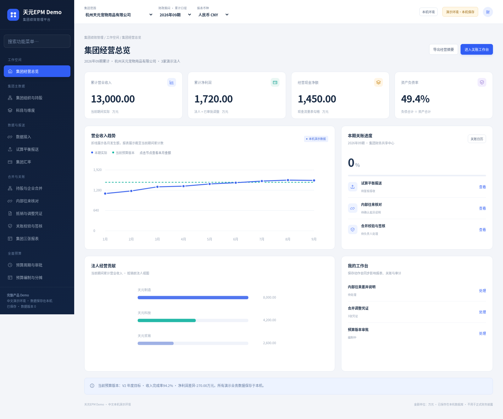
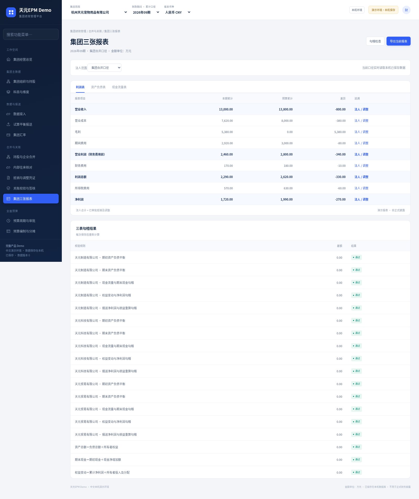
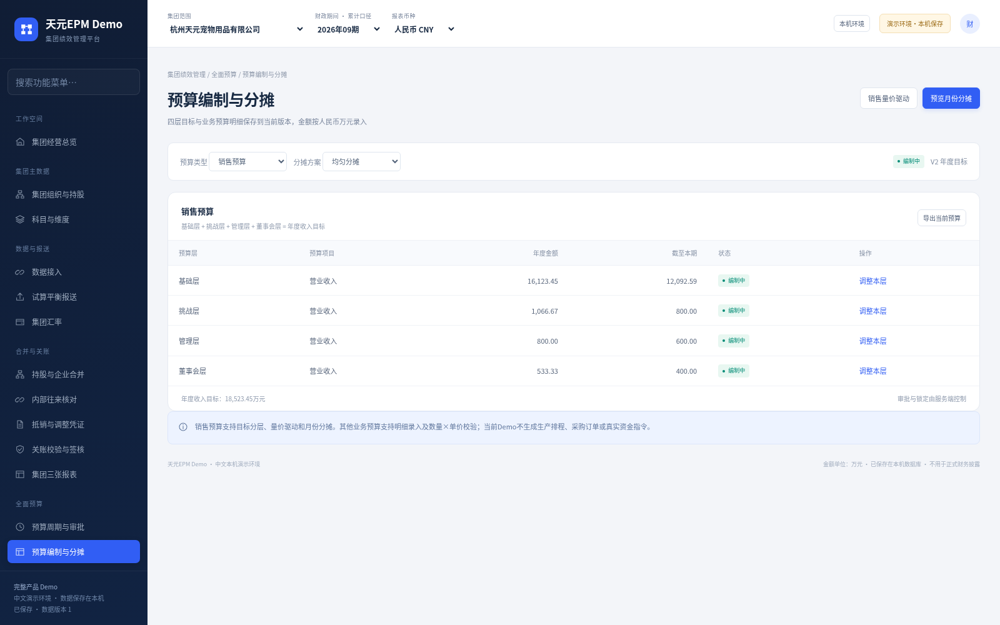
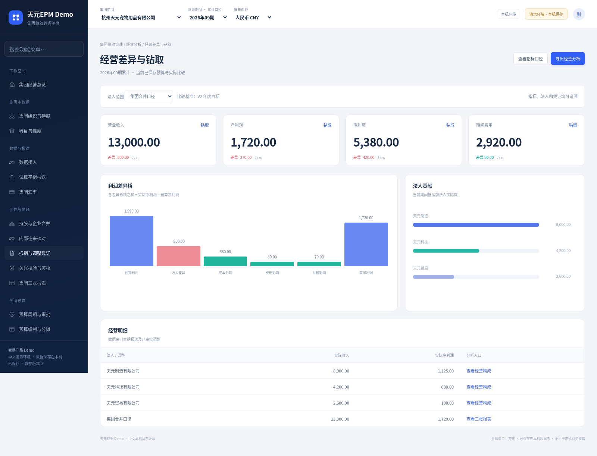
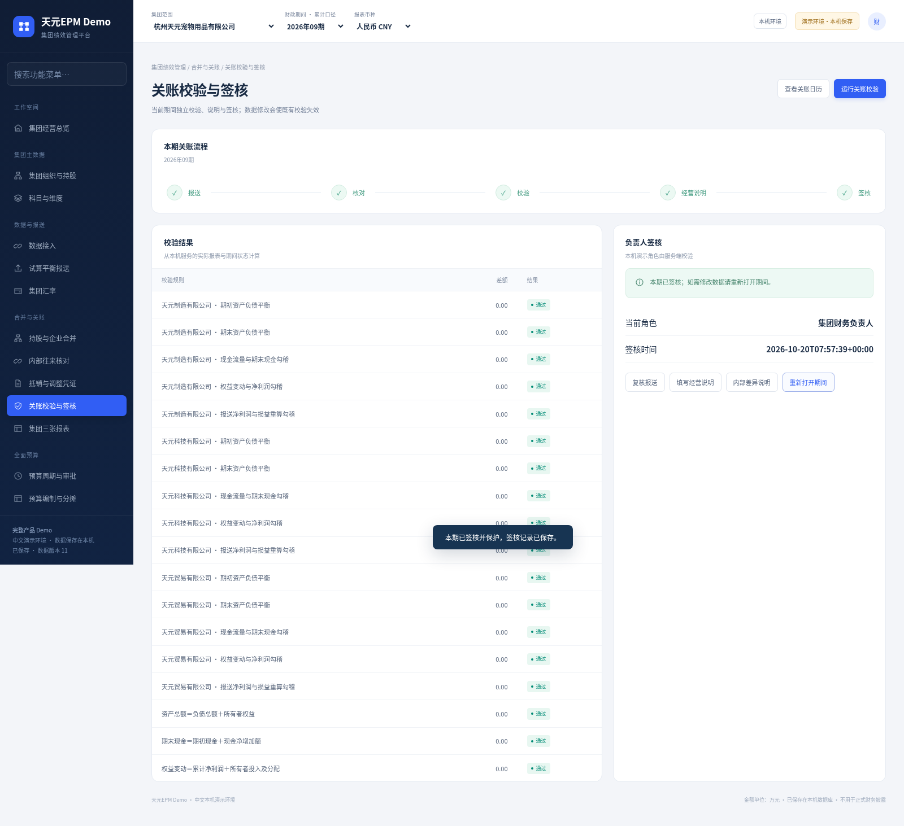

# 用户操作手册

杭州天元宠物用品有限公司 · 全中文 EPM 演示环境

文档版本：V1.0  
编制日期：2026年10月20日  
适用软件：天元EPM Demo，Windows 10/11 64位中文本机演示版  
适用读者：集团财务负责人、法人会计、经营分析人员、预算编制人员和产品评审人员

## 1. 使用本手册前先了解的事项

### 1.1 本手册对应哪一套软件

本手册对应按完整产品原型实现的独立中文 Demo。完整解压运行包后，启动文件名称为“天元EPM Demo.exe”。它提供集团合并报表、预算编制与审批、经营分析以及本机保存的演示操作。

主公司名称按需求显示为“杭州天元宠物用品有限公司”。预置子法人、责任人、交易和全部财务金额均为虚构样例，不代表该公司的真实业务或财务状况。操作时看到“演示环境·本机保存”，表示样例及修改会保存在当前电脑，并不表示已经连接公司的真实账套。

此前的 Frappe／Konsolidat 平台与本 Demo 分别运行。旧平台数据不会自动进入新 Demo。请从新 EXE 打开页面，不要使用旧平台收藏的固定网址，不需要谷歌邮箱、注册账号或英语初始化向导。

### 1.2 如何阅读三份交付文档

|文档|主要回答的问题|建议读者|
|---|---|---|
|系统研发与交互说明书|系统如何实现，页面如何调用服务，数据如何保存及计算，研发如何接续开发|研发、架构、测试、实施|
|产品说明书（含演示案例）|产品包含哪些能力，各模块如何联动，如何用完整案例评审产品|产品、财务负责人、经营管理者|
|本用户操作手册|从哪里点击、字段怎么填、保存后看哪里、遇到错误如何处理|实际操作人员|

第一次使用建议先按第2章完成上手路线，再按需要阅读对应章节。需要修改演示财务数据前，先查看第15章的保存与备份说明。产品说明书中的案例可以作为本手册步骤的练习材料。

### 1.3 本轮演示的关键口径

|项目|本轮口径|操作时应注意|
|---|---|---|
|会计年度|固定为2026年|不能通过修改配置建立新年度|
|实际期间|支持1至12期查看；初始实际样例截至9期|未独立导入时10—12期沿用9期累计数|
|预算期间|全年12期|预算全年金额与本期累计金额不能混用|
|基础金额单位|人民币万元|输入100代表100万元，不是100元|
|美元视图|人民币万元除以保存的美元展示汇率，单位万美元|切换展示币种不改变录入基准，录入仍按人民币万元|
|数据性质|本机持久化的虚构演示数据|不能直接作为正式报账、审计或对外披露依据|
|使用模式|当前电脑上的单机演示|演示角色切换不是公司正式账号授权|

## 2. 一页上手：第一次打开与推荐操作路线

### 2.1 完整解压并启动

1. 下载 Windows 运行 ZIP，并将整个压缩包解压到电脑普通文件夹，例如“D:\天元EPM演示”。不要在 ZIP 预览窗口内直接双击 EXE。
2. 打开解压后的“TianyuanEPMDemo”文件夹，确认其中同时存在 EXE 和“python、app、backend、frontend”等目录。
3. 双击“天元EPM Demo.exe”，等待浏览器自动打开中文工作台。
4. 确认顶部公司为“杭州天元宠物用品有限公司”，期间为“2026年09期”，报表币种为“人民币 CNY”。
5. 确认侧栏可看到集团主数据、数据与报送、合并与关账、全面预算、经营分析和治理后台等分组。

电脑无需另装 Python、Docker、WSL 或虚拟机；首次运行也无需联网下载其他基础环境。程序使用包内运行库，因此请保留解压后的目录结构。

### 2.2 十步完成第一次演示

|步骤|进入位置|执行动作|成功确认|
|---|---|---|---|
|1|集团经营总览|查看默认9期集团指标|初始收入13,000、净利润1,720，单位万元|
|2|集团三张报表|依次切换三张报表，查看勾稽|资产等于负债加权益，期末现金与流量衔接|
|3|版本与多情景|复制当前版本，起一个唯一的练习名称|新版本变为“编制中”，原版仍在列表|
|4|预算编制与分摊|调整基础层，点击“保存本层”|提示已保存，年度目标同步变化|
|5|预算周期与审批|依次提交、审核、锁定|状态依次为审核中、已审批、已锁定|
|6|预算调整与滚动预测|发起并批准一笔调整|生成独立新版本，原版金额不变|
|7|经营差异与钻取|查看当前预算版本与实际的差异|比较基准为所选版本，可打开追溯|
|8|关账校验与签核|完成报送、说明、校验后签核|本期显示已签核及签核时间|
|9|系统配置→本机环境工具|查看数据目录，点击安全退出并确认|页面显示已安全退出，数据已保留|
|10|重新双击EXE|进入版本及审计页面复查|练习版本、金额和操作记录仍存在|

第一次演示不必先导入 CSV。预置账套可用于查看三表及完成流程。CSV、法人和科目变更会实际改动演示账套，建议熟悉保存、期间和备份后再练习。

### 2.3 默认数字的核对表

下表适用于首次初始化且未发生后续导入、凭证审批或主数据变更的2026年09期集团人民币口径。已修改的环境应与自己上一步操作结果比较，不能要求它恢复为下表。

|指标|初始金额（人民币万元）|
|---|---|
|累计营业收入|13,000.00|
|累计净利润|1,720.00|
|资产总计|9,580.00|
|负债合计|4,730.00|
|所有者权益合计|4,850.00|
|经营活动现金流量净额|1,450.00|
|期末现金及现金等价物|2,050.00|



## 3. 认识工作台与通用操作

### 3.1 界面区域

顶部用于选择集团范围、财务期间和报表币种；右侧有“本机环境”入口与当前演示角色头像。左侧为菜单导航和菜单搜索。中央显示当前页面、业务按钮、指标卡片、表格、图表及弹出表单。侧栏底部显示保存状态和数据版本。

屏幕较小时，可滚动左侧菜单查看后面的经营分析与治理后台。菜单搜索只筛选功能名称，不搜索凭证、科目或财务数据。清空搜索文字即可恢复全部菜单。

### 3.2 三个全局筛选如何使用

|筛选|可选内容|影响范围|不会执行的动作|
|---|---|---|---|
|集团范围|主集团、天元制造子集团|当前范围报表、分析及期间流程|不会自动改写法人档案|
|财务期间|2026年01至12期|累计实际、本期关账状态、CSV导入对应月份、当期凭证|不会自动生成未来实际业务|
|报表币种|人民币CNY、美元USD|当前展示金额与相应导出|不会执行结汇或改变基础录入金额|

“集团三张报表”和“经营差异与钻取”另提供法人范围选择。选择具体法人时查看该法人抵销前报送口径；集团合并口径包含适用的已审批调整，因此法人收入简单相加可能不同于集团收入。

预算版本是全年数据快照，不是切换月份时自动新建一份预算。当前版本影响编制和预实比较；切换月份只改变该版本累计比较到哪个期间。预算状态和财务期间签核属于两套流程，锁定预算不等于关闭财务期间。

### 3.3 输入、保存、关闭和刷新

弹窗中输入后，必须点击对应保存按钮才会写入数据库；点击“关闭”、右上角“×”或按 Esc 只关闭弹窗。未保存输入不能视作已经留存。保存成功后通常会关闭弹窗，显示中文提示，并更新侧栏“已保存·数据版本”以及相关表格。

同一电脑打开多个标签页时，某一标签页可能先修改数据。若提示“其他操作已更新数据”，系统会读取最新内容；应核对最新金额，再重新打开表单操作。不要通过反复快速点击保存来绕过提示。

按钮呈禁用状态时通常表示预算状态不允许、当前页面为只读口径或对应功能仅用于展示。即使部分按钮仍可点击，服务端也会校验角色与期间状态；以实际中文结果为准。出现错误时不应把表单中的数值当作已保存值，可刷新或重开该记录确认。

### 3.4 完整20项导航

|分组|导航名称|主要用途|
|---|---|---|
|工作空间|集团经营总览|看收入、利润、现金、趋势、贡献及关账进度|
|集团主数据|集团组织与持股|查看组织，新增或编辑演示法人档案|
|集团主数据|科目与维度|查看和维护集团科目，查看维度与报告层级|
|数据与报送|数据接入|下载模板，导入CSV，查看接入批次|
|数据与报送|试算平衡报送|查看法人累计余额并复核接收当前期|
|数据与报送|集团汇率|维护美元展示汇率|
|合并与关账|持股与企业合并|查看演示持股及合并方法|
|合并与关账|内部往来核对|记录当前期内部交易差异核对说明|
|合并与关账|抵销与调整凭证|查看凭证，新建草稿，由负责人审批|
|合并与关账|关账校验与签核|完成前置任务、校验、签核及重新打开期间|
|合并与关账|集团三张报表|查看三表、追溯、勾稽及导出|
|全面预算|预算周期与审批|提交预算、审核、锁定及查看操作记录|
|全面预算|预算编制与分摊|目标分层、量价、分摊与业务预算明细|
|全面预算|预算调整与滚动预测|申请调整并生成独立版本或预测草稿|
|全面预算|版本与多情景|复制、切换和比较完整预算版本|
|经营分析|经营差异与钻取|查看预实比较、利润差异桥及法人贡献|
|经营分析|管理报表中心|进入现有业务报表或打印当前视图|
|治理后台|组织权限|查看权限矩阵，切换本机演示角色|
|治理后台|审计轨迹|查看并导出实际保存操作记录|
|治理后台|系统配置|维护集团名称，查看本机位置及安全退出|

## 4. 演示角色及其操作范围

### 4.1 切换角色

进入“组织权限”，点击“切换演示角色”，选择角色，再点击弹窗中的“切换角色”。头像也提供相应角色入口。切换后回到业务页面，检查当前角色文字；以它决定能否执行审批和配置。

这里是单机流程体验。当前启动凭证持有人能够切换三种角色，不需要创建邮箱账号；它不是生产身份认证，也未提供法人之间的数据读取隔离。法人会计仍可读取集团演示报表，不应把本环境理解为已完成企业权限建设。

### 4.2 真实操作权限表

|操作|集团财务负责人|法人会计|审计只读|
|---|---|---|---|
|查看集团和法人报表、分析、审计|允许|允许|允许|
|保存预算层、量价、分摊及业务明细|允许|允许|禁止|
|提交预算、复制或切换版本、发起预算调整|允许|允许|禁止|
|审核预算、锁定版本、批准或退回调整|允许|禁止|禁止|
|CSV导入、报送复核、内部说明、经营说明、运行校验|允许|允许|禁止|
|新增调整凭证草稿|允许|允许|禁止|
|审批凭证、签核、重新打开期间|允许|禁止|禁止|
|保存法人、科目、汇率和集团设置|允许|禁止|禁止|
|查看本机路径、打开数据目录、安全退出|允许|允许|允许|

“切换预算版本”会更新演示环境的活跃版本，是服务端保存动作，因此审计只读不能执行。只读用户可查看当前版本及版本清单。角色不同产生的业务拒绝，不代表软件故障；需要审批时切回集团财务负责人。

## 5. 集团组织、科目、持股与汇率

### 5.1 新增和编辑法人档案

进入“集团组织与持股”，点击“新增法人”，按下表填写，点击“保存法人”。已有法人在组织树中点击“编辑档案”进入维护。保存后重新打开同一档案，核对编码、名称和责任人。

|界面字段|填写要求|示例及注意事项|
|---|---|---|
|法人标识（英文或数字）|2—20位，以大写字母开头，后续可用大写字母、数字、下划线和短横线|如TYNEW；已有标识不能在编辑表单改写|
|法人编码（必填）|非空、同一环境唯一，最多100字|如TY04；CSV通常填写此业务编码|
|法人全称（必填）|非空、最多100字|如天元演示服务有限公司|
|简称|填写非空简称，最多100字|虽未标“必填”，保存仍要求有内容|
|报送责任人|填写非空责任人，最多100字|用于展示报送职责，不会自动创建账号|
|本位币|当前选择人民币CNY|本轮不支持不同法人各自使用外币本位币|

新增法人初始财务金额为零。需要看到非零报表，应导入它当前期的整套试算余额。新增法人不会自动分配年度销售预算占比；不要把它在演示预算分解中显示为零理解成已经完成法人预算分配规则。

主数据维护可能影响多个期间。若已有期间签核，系统会要求先由负责人重新打开关联期间，再允许相关修改。不要为改一个名称删除整套数据。当前页面没有删除法人或调整任意持股链的功能。

### 5.2 维护集团科目

进入“科目与维度”，选择“集团科目表”，点击“新增科目”，或在已有科目行点击“编辑”。填写后点击“保存科目”，再在清单中核对报表口径和余额方向。

|字段|规则|为什么需要核对|
|---|---|---|
|科目编码|1—20位字母、数字、下划线或短横线；已有编码在表单中只读|CSV及凭证依此识别科目|
|科目名称|非空、最多100字|显示在凭证及科目清单|
|科目类型|资产、负债、权益、收入、成本、费用或税费|为业务分类，需与口径一致|
|余额方向|借或贷|决定试算余额和分录影响的正负方向|
|报表口径|从系统内置项目中选择|决定金额进入收入、存货、应付等哪个报表项目|

不要仅为让导入通过而随意改变既有科目的方向或口径。映射改变可能影响后续导入及调整计算，系统并不替代会计政策审定。“管理维度”和“报告层级”页签用于查看当前支持的法人、期间、预算层和报表规则，未提供任意新增维度建模器。

“导出当前清单”导出集团科目表，供整理CSV和研发核对。导出的管理清单带有说明行，不是试算余额导入模板。

### 5.3 查看持股与合并范围

“集团组织与持股”和“持股与企业合并”中的“查看合并范围”列出当前范围的法人编码、名称及合并方法。后一个页面展示演示母子关系、持股比例和全额合并方法。

这两个页面主要用于查看控制关系和维护法人档案。购买日估值、购买价分摊、股权变更审批、交叉持股和多层少数股东计算未在本轮提供完整操作。页面中的会计准则名称属于演示设置说明，不能据此推断全部准则处理已完成。

### 5.4 维护美元展示汇率

由集团财务负责人进入“集团汇率”，点击“新增或编辑汇率”或美元行的“编辑汇率”。币种固定为USD，填写币种名称和“1美元折合人民币”，点击“保存汇率”。汇率必须大于零、不超过1,000,000，最多保留6位小数。

初始汇率为7.1，表示1美元折合7.1元人民币。切换美元视图后，人民币万元数除以7.1得到万美元数；修改汇率会同步影响美元展示和相应导出。它不连接行情、不执行结汇，也未区分交易日、平均、期末等正式外币折算政策。

## 6. 数据接入与试算余额报送

### 6.1 准备完整的当前期CSV

“数据接入”可点击“下载空白模板”，“试算平衡报送”可点击“下载空白报送模板”。得到的是UTF-8 CSV，只带规定列头。用Excel或WPS编辑时，请另存为UTF-8 CSV，并确认没有多余说明行、隐藏标题或新增列。

第一行及顺序必须严格如下，不增加空格、注释或单位行：

```csv
法人编码,期间,科目编码,借方余额,贷方余额
```

|列|填写方式|校验要求|
|---|---|---|
|法人编码|如TY01、TY02、TY03|必须已存在；也支持内部标识MFG等，但建议用界面业务编码|
|期间|如2026-09|必须与顶部选择期间完全一致|
|科目编码|如1002、6001|必须已在集团科目表维护|
|借方余额|如100.00或0|非负、最多两位小数，填写纯数字|
|贷方余额|如0或100.00|非负、最多两位小数，不能与借方同时为正|

允许某科目两边都为零。不要使用“1,000.00”等带千分位的金额或“100万元”等带文字的金额。每个法人本批必须借方合计等于贷方合计；同一法人同一科目只出现一次。

文件选择入口限制2MiB以内，服务端还会检查字符数和请求总字节数，最多10,000条数据行。建议文件明显小于2MB。需要分批时，以“一个法人一个期间的完整余额”为单位拆分，不能把同一法人同一期的一套科目拆成前后两批；后批会覆盖前批。

### 6.2 导入的含义：替换当期整套累计余额

导入不是增加一笔差额。文件中列出的每家法人，在当前期间的整套累计余额会被替换；未列出的科目会按新余额中的零参与计算，不会自动保留旧值。文件没有涉及的法人以及其他期间不因此被覆盖。

实际导入哪家法人由CSV每行“法人编码”决定，不是由当前报表页的法人筛选限制。同一文件可以包含多家法人，应在导入前逐家核对。为避免错误，上传时可先回到主集团、人民币视图，并明确选好期间。

软件保留历史导入批次、来源名称、行数、时间和解析行，用于追溯；当前报表采用最新覆盖的当前期数据。重复导入同一文件会形成新的批次，因此不应靠反复上传判断软件是否已保存。

### 6.3 执行导入

1. 确认角色为集团财务负责人或法人会计；确认目标月份没有关联集团签核保护。
2. 在顶部选择目标期间，例如2026年09期。
3. 在“数据接入”点击“导入试算余额”，或在“试算平衡报送”点击“导入报送”。
4. 在弹窗中选择本机CSV文件；选择后文件文字会载入“CSV内容（可粘贴）”，来源名称也会带入。
5. 检查来源文件名称、表头、法人编码、期间和金额。也可直接将完整CSV粘贴到内容框。
6. 点击“校验并导入”，等待“试算余额已整批校验入库，当前期间报表已更新”的成功提示。
7. 查看最近接入批次，并进入“集团三张报表”核对本期变化；必要时切到其他月份确认没有覆盖。

不要从本手册复制两行示意数据当成完整试算余额。软件包“backend/examples”附有完整示例“试算余额_2026年09月_示例.csv”和空白模板，可先在练习账套中核对后使用。样例不是公司真实数据。

### 6.4 导入失败与整批回滚

|提示方向|常见原因|处理办法|
|---|---|---|
|表头不符合模板|多了标题、列名改动、列顺序变化|重新下载空白模板，保留准确第一行|
|法人或科目不存在|编码拼写错误或尚未维护|对照主数据核实，必要时负责人先建档|
|期间不一致|顶部选8期但文件写2026-09|明确目标期间后同时核对界面和文件|
|同一法人科目重复|重复粘贴、将同科目拆多行|先按法人和科目汇总为一行|
|借贷余额同时为正|把双向发生额填入余额列|按试算余额口径整理，不能两边均为正|
|法人试算不平衡|漏科目、金额单位不一、方向填反|逐法人重算借贷合计，再提交完整套|
|正文过大|文件接近上限或包含过多文字|按法人完整套合理分批|

系统发现任一坏行或任一法人不平衡时，整批拒绝。不会先导入正确行，再留下半批错误。按中文提示中的行号修改后再重试；失败后可重开报表核对，原已保存金额应保持。

### 6.5 复核并接收本期

进入“试算平衡报送”，在各法人行点击“检查与追溯”，核对法人编码、当前期、累计收入、累计净利润和批次。确认后点击“复核并接收本期”。成功后卡片显示“已接收”，清单状态显示已复核。

这个动作记录当前集团及月份的复核接收状态，不会自动替各法人创建独立生产审批单。即使未新导入CSV，也可对预置演示数据完成复核。后续导入或审批财务调整会使该月份的旧确认和校验失效，需要重新执行。

CSV只有累计余额，没有现金流明细。导入后系统沿用样例期初现金和样例投资、筹资流量，以现金变动倒算经营现金流，属于演示估算；不能因为勾稽通过就认定真实现金流分类已正确完成。

## 7. 内部核对与调整凭证

### 7.1 保存内部差异核对说明

进入“内部往来核对”，点击“确认差异说明”；已有说明时按钮为“查看或更新差异说明”。填写“差异说明（必填）”，点击“保存并确认说明”。说明非空、最多500字，保存到当前集团及期间。

成功后确认状态为已确认，说明状态为已保存，可再次打开查看。这个动作保存核对依据，不会自动生成抵销分录或改变利润。需要记账调整时，应另到“抵销与调整凭证”保存并审批凭证。

### 7.2 新建平衡凭证草稿

进入“抵销与调整凭证”，确认顶部月份，再点击“新增调整凭证”。当前界面可填2至4行有效分录，零金额行自动忽略。填写下表字段后点击“保存凭证草稿”。

|字段|要求|示例|
|---|---|---|
|凭证摘要（必填）|非空、最多100字|补提本期管理费用|
|类型|合并调整、往来抵销、未实现利润|按用途选择|
|现金流类别|不涉及现金科目，或经营/投资/筹资活动|含现金科目必须选具体活动|
|调整依据（必填）|非空、最多500字|说明调整原因、业务依据和演示用途|
|集团科目|从现有科目中选择|6602期间费用、2241其他流动负债|
|借方、贷方金额|人民币万元、非负、最多两位小数|每行只能一侧为正，整张借贷相等|

例如在同一行同时输入借方10和贷方10，即使整张看似相等也会拒绝。应将借、贷分别放在不同分录行。借方合计必须严格等于贷方合计，不能用小数尾差“差不多相等”处理。

### 7.3 草稿与审批的区别

草稿保存后会出现在当前期清单，状态为“草稿”，但不会影响报表。由集团财务负责人点击“复核并审批”，检查凭证摘要和编号，再点击弹窗“确认审批”。审批后状态为“已审批”，当前期三表重新计算。

练习可使用借记6602期间费用10、贷记2241其他流动负债10。未发生其他变化时，初始集团净利润会由1,720变为1,710；若环境已经改动，则应核对审批前后净利润减少10，而非强求固定总额。草稿阶段净利润不应变化。

含现金科目的凭证必须选择现金流活动类别，例如现金增加100、收入增加100且属于经营活动时，应选择“经营活动”。选择空的“不涉及现金科目”会拒绝保存。正确分类会影响现金流量表，并与期末现金勾稽。

审批凭证会影响本期及关联范围的校验确认。当前Demo未提供已审批凭证直接撤销、删除或修改按钮；需要更正时，应由财务负责人确认会计处理后使用新的平衡反向凭证留痕。不要修改数据库文件来“删除错误凭证”。

## 8. 查看集团三张报表

### 8.1 利润表、资产负债表和现金流量表

进入“集团三张报表”，确认集团范围、期间、币种及法人范围，再点击对应页签。利润表显示本期累计、预算累计、差异及追溯；资产负债表和现金流量表显示当前金额与依据入口。

初始集团营业收入13,000万元已包含演示内部销售抵销，不能直接用三家法人收入相加替代。科目、导入、已审批凭证共同决定实际数；预算列取当前活跃预算版本。资产、现金及负债数字改变，应沿报送或凭证检查原因。



### 8.2 追溯与勾稽

利润表行点击“法人 / 调整”，查看当前范围的法人来源金额、抵销及调整和合并结果。可继续“查看报送”或“查看凭证”。资产负债表和现金流量表的“查看依据”显示当前报表对应行金额及校验结果，是本轮演示依据展示，不是所有总账原始单据的完整穿透查询。

点击“勾稽检查”查看规则、差额及是否通过。重点检查资产等于负债加权益、期末现金等于期初现金加净增加额，以及权益变动与利润衔接。勾稽校验是检查已输入数据，不是自动填补错误或代替会计判断。

### 8.3 导出当前报表

点击“导出当前报表”，浏览器下载UTF-8 CSV。导出使用当前期间、范围、币种及已保存数据，并带演示说明和抬头。利润表导出含实际、预算及差异；另两张表导出对应项目金额。

导出管理报表不是导入模板。不要将含演示说明行和抬头的导出文件原样上传到“试算余额”入口。用Excel或WPS打开后若出现编码问题，可在导入文本时选择UTF-8；金额单位以文件抬头为准。

## 9. 预算版本与编制准备

### 9.1 先明确当前活跃版本

预算的四个菜单共用当前活跃版本。初始版本包括“V1 基准预算”和“V2 年度目标”；默认活跃V2，年度收入目标18,400万元。版本清单会显示名称、情景、年度目标及状态。

建议练习前先进入“版本与多情景”，点击“复制当前版本”，输入唯一名称，例如“用户练习_20261020”，情景选择年度预算、滚动预测或压力情景，然后“保存新版本”。系统保存完整独立草稿并自动切换至它。已有同名版本会被拒绝，可加日期或序号。

版本复制保留层级、分摊、量价、业务明细等快照，原版金额与状态保持。复制预算并不能隔离财务报送或调整凭证；实际财务账套仍是同一份，因此财务练习要依照备份与期间说明操作。

### 9.2 状态与可执行动作

|预算状态|允许的主要操作|下一步|
|---|---|---|
|编制中|修改目标、分摊、量价和业务明细，提交|提交本版审批|
|审核中|查看、比较、复制新版本；负责人审核|集团审核通过|
|已审批|查看、复制、发起调整；负责人锁定|锁定已审批版本|
|已锁定|查看、复制或发起独立预算调整|保留原版，另做新版本|

不要把“退回调整申请”理解为把已经锁定的预算重新变成草稿。调整申请有独立状态。当前演示未提供预算审核中的单独退回按钮；要另做方案，可复制新版本编制。

## 10. 预算编制、量价与分摊

### 10.1 修改四层销售目标

进入“预算编制与分摊”，预算类型选择“销售预算”，确认版本状态为编制中。在需要修改的层点击“调整本层”，输入“年度金额（人民币万元）”，点击“保存本层”。金额非负、最多两位小数。

四层是增量相加的年度收入目标：基础层＋挑战层＋管理层＋董事会层。初始四层分别16,000、1,066.67、800、533.33，合计18,400。如果只把基础层改为16,123.45且其余保持初始值，年度收入目标变为18,523.45。

成功保存后，清单年度及截至本期金额、年度目标汇总、月份分摊和经营分析比较都会更新。浏览器刷新后检查同一版本金额；不要以输入框暂存内容判断是否已经保存。

### 10.2 使用量价驱动

点击“销售量价驱动”，输入“年度销量（整数）”和“不含税单价（人民币万元）”，点击“应用并保存目标”。销量为非负整数，单价非负且最多两位小数；销量乘单价形成全年收入目标。

系统保留当前前三层，把新年度目标与前三层合计之间的差额放入董事会层。因此量价总额不能小于当前前三层之和，否则董事会层会变负并被拒绝。初始状态销量2,000、单价9.20对应18,400；操作时应按照自己当前版本的前三层核对，而不是套用其他版本金额。

### 10.3 查看和更改全年分摊

在“分摊方案”下拉中选择“均匀分摊”或“季节性权重”，选择后即执行保存。再点击“预览月份分摊”核对12个月份、权重及金额。各月保留两位小数，全年合计保持等于年度目标。

均匀方案按12期分摊；季节性权重为5%、5%、7%、8%、8%、9%、9%、9%、10%、10%、10%、10%。小数尾差按累计分摊处理，因此均匀方案各月可能差0.01，并非保存错误。



### 10.4 录入其他业务预算明细

在预算类型中选择生产预算、采购预算、库存预算、人工预算、费用预算、资本预算或资金预算，点击“新增预算明细”。已有明细行可点击“编辑”。填写后点“保存预算明细”，成功后核对清单及当前版本。

|字段|要求|填写建议|
|---|---|---|
|预算项目名称（必填）|非空、最多100字|写清项目或业务类别|
|数量|非负、最多两位小数|纯金额预算可填1|
|单价（人民币万元）|非负、最多两位小数|纯金额预算填该笔金额|
|预算金额（数量×单价）|必须等于数量乘单价保留两位小数|修改数量或单价后系统自动带算|
|业务说明|可空、最多300字|说明测算依据及演示用途|

例如录入费用预算“年度展会费用”，数量1、单价120，金额为120万元。若人为把金额改为999，服务端会拒绝不一致的保存。各业务预算明细按版本独立保存，复制版本时会带入。

“三表预算口径”用于查看年度收入和演示成本费用比较基准，未提供完整预算资产负债表、现金流自动编制模型。其他业务明细不会自动产生生产排程、采购订单、工资或真实付款，也不会自动汇入完整三表预算。

## 11. 预算提交、审核、锁定与调整

### 11.1 提交、审核和锁定

1. 在编制中版本检查四层、分摊及业务明细，进入“预算周期与审批”。
2. 点击“提交本版审批”，状态变为“审核中”。此后不能直接改原版本编制数据。
3. 切换集团财务负责人，点击“集团审核通过”，状态变为“已审批”。
4. 点击“锁定已审批版本”，状态变为“已锁定”。
5. 点击“查看审批记录”，确认实际时间、角色和预算动作；也可到审计轨迹查看。

审核、锁定是依次执行的动作，不支持从编制中直接锁定。角色不满足或状态不正确时，系统会提示原因。不要把按钮未灰或弹窗打开理解成已经获准审批。

### 11.2 发起并批准独立预算调整

进入“预算调整与滚动预测”，点击“发起预算调整”。来源版本为当前活跃版本，不能在此随意改成另一个版本；要调整其他版本，先到版本清单切换。

|字段|填写要求|
|---|---|
|来源版本|只读，核对要调整的基准版|
|年度收入增量（人民币万元）|可正可负、最多两位小数、不能为零|
|调整预算层|从四层中选择|
|调整原因（必填）|非空、最多500字，说明业务理由|

点击“保存调整申请”，系统记录来源快照，原版金额保持不变。负责人点击该申请“查看与审批”，确认层级、增量和原因后，“批准并生成新版本”。系统生成已审批的独立调整版本并切换到它；源版本仍可在清单中查看。

负向调整不能使所选层金额小于零。调整不是在审批时直接覆盖当时活跃的其他版本，而是基于申请时保存的来源快照。批准前若已切换版本，仍应在申请详情中认真确认原版本。

点击“退回申请”会将申请改为已退回，并记录本轮固定退回说明。已处理申请不能反复批准。需要重新发起时，确认版本后另建申请，不要认为退回自动恢复原版可编辑。

### 11.3 滚动预测和版本比较

“创建滚动预测版本”或“创建预测版本”会复制当前快照为独立编制草稿，情景为滚动预测。它不是自动读取未来订单的预测引擎，未来业务假设仍需人工录入。

在“版本与多情景”点击“比较版本”查看各版年度目标和状态；点击“切换本版”载入完整快照。切换后预算编制、审批、经营分析比较都使用新活跃版本。保存后重启也保留这个选择，演示时应向其他同机操作者说明当前比较基准。

## 12. 经营分析、驾驶舱与管理报表

### 12.1 查看经营驾驶舱

“集团经营总览”汇集累计营业收入、累计净利润、经营现金净额和资产负债率。收入趋势折线显示各月发生额，而卡片和财务报表显示截至当前期间累计数。点击趋势节点可查看该月金额，不应将一个月节点与累计卡片直接比较。

法人经营贡献图为抵销前口径，集团合并结果另加适用抵销和调整。工作台中的处理入口可进入内部核对、凭证和预算审批；关账进度由本期任务状态决定，不表示所有生产功能已完成建设。

### 12.2 预实差异与钻取

进入“经营差异与钻取”，先核对期间、法人范围、币种及“比较基准”版本。点击收入、净利润、毛利额、期间费用卡片中的“钻取”，查看法人来源与调整；法人明细“查看经营构成”可打开该法人报送指标。

利润差异桥由预算利润出发，叠加收入、成本、费用、财税影响到实际利润。点击图形可查看口径说明。当前销售预算使用保存的目标版本；成本费用等比较使用固定演示基准，不能把一条业务费用预算明细当作已自动改变整个利润预算。



### 12.3 导出与管理报表入口

点击“导出经营分析”导出当前口径已保存的经营摘要。“管理报表中心”提供集团合并报表、经营分析、关账签核、内部往来说明、法人报送追踪和预算执行报告的入口，点击“打开报表”跳转到相应实际页面。

“打印当前视图”调用浏览器打印，可由浏览器选择打印机或另存为PDF。它不会自动生成所有模块合并成册的管理报告。对外转发前应保留演示标识、期间、范围和单位，防止把虚构数字误作正式经营报告。

## 13. 关账校验、签核与重新打开期间

### 13.1 签核前必须完成的事项

|前置条件|可操作位置|完成标志|
|---|---|---|
|法人报送复核接收|试算平衡报送，或关账页“复核报送”|本期报送已接收|
|内部交易说明|内部往来核对，或关账页“内部差异说明”|说明已确认|
|经营差异说明|关账页“填写经营说明”|说明非空并已保存|
|本期有效财务校验|关账页“运行关账校验”|规则通过且校验仍对应当前数据|
|负责人身份|组织权限切换演示角色|集团财务负责人|

经营差异说明最多3,000字，应说明本期收入、利润、预算偏差和需跟踪事项。它保存到当前集团和期间，不会自动复制成下一月说明。默认内部说明可按实际演示情况改写，不应直接保留不符合案例的文字。

### 13.2 完成签核

1. 确认目标集团及月份，例如主集团2026年09期。
2. 完成上表报送、内部说明和经营说明。
3. 点击“运行关账校验”，查看实际规则及差额；有未通过项先查报送和凭证。
4. 确认校验后未再修改财务数据，以集团财务负责人点击“确认并签核”。
5. 成功后显示本期已签核和签核时间，相关财务修改受保护。

“查看关账日历”展示本期任务、责任角色和当前完成状态，不是可任意拖动的生产排程日历。未满足前置条件时，系统会拒绝签核并给出中文原因；不要通过重复点击绕过。



### 13.3 为什么刚通过的校验会失效

CSV导入、凭证审批及相关主数据变更会改变财务来源。系统会使旧校验、报送确认和内部核对状态失效，要求重新确认。预算金额变化与实际财务源不同，不应把预算审批当作财务关账的替代步骤。

各月份状态独立保存。9期已签核不代表8期已签核；切换集团或月份后，必须查看对应流程。涉及共享同月财务源时，另一关联集团已经签核也可能阻止当月修改；按提示先由负责人重新打开关联范围。

### 13.4 重新打开期间

在已签核期间点击“重新打开期间”，填写“重新打开原因（必填）”，点击“确认重新打开”。原因非空、最多500字。成功后可以按角色修改允许的数据，原校验与确认需要重新执行。

重新打开不会删除历史凭证或还原财务金额，也不会撤销预算锁定。完成修改后，重新复核报送、确认内部说明、核对经营说明、运行校验并再次签核。重新打开和后续动作会留在审计轨迹中。

## 14. 审计轨迹与集团配置

### 14.1 查看和导出实际操作记录

进入“审计轨迹”，查看时间、角色、中文动作及业务对象。记录由保存和审批事务生成，例如修改预算、导入批次、审批凭证、签核和重新开启。它不是页面浏览次数统计；单纯打开报表不会自动形成业务保存记录。

点击“导出审计记录”可下载当前载入的操作记录。页面展示最近200条记录；更早数据保存在数据库中，若需要全量查询或合规审计导出，应由研发另行提供受控查询。导出的角色是演示会话角色，不能当作已验证的真实员工身份。

### 14.2 保存集团名称

由集团财务负责人进入“系统配置”，在“集团名称（必填）”维护名称，点击“保存配置”。名称非空、最多100字，保存后系统范围显示和导出抬头随之更新。当前需求名称为“杭州天元宠物用品有限公司”，不需要为体验流程随意改名。

财政年度、报表基础币种、会计日历、界面语言及基础金额单位均按当前演示口径只读。年度固定2026，不支持通过把2026改为2027来建立新账套；新年度建账属于后续正式研发。

## 15. 本机保存、安全退出与备份

### 15.1 找到当前实际数据位置

点击顶部“本机环境”，或进入“系统配置”点击“本机环境工具”。弹窗列出当前角色、保存状态、界面语言、本机数据目录和运行日志目录。路径字段可选中复制，使用“打开数据目录”可在Windows打开资源管理器。

默认数据目录是“%LOCALAPPDATA%\TianyuanEPMDemo”，主数据库名称为“epm-demo.sqlite3”，日志位于其中“logs”文件夹。实际目录以弹窗为准，因为研发人员可以指定独立数据目录。程序解压目录和业务数据目录是两个不同位置。

默认数据目录中“instance.json”包含当前本机临时登录凭据，不要公开发送或放到公共仓库。提供故障信息时发送错误文字即可，不要整个压缩运行中的数据目录发给无关人员。

### 15.2 正确安全退出

先完成表单保存，确认提示成功，再在本机环境弹窗点击“安全退出”。确认弹窗中点击“确认安全退出”。页面显示“已安全退出”，说明服务停止并保留已保存的数据。再次双击EXE将读取同一数据目录。

关闭浏览器、关闭标签页或关闭下载窗口不会停止后台服务；再次双击EXE通常复用已验证的本机实例。电脑重启会停止进程，但之前成功提交的数据应保留。仍未点保存的表单内容不在保留范围内。

不要仅为了退出而在任务管理器强制结束进程。普通用户优先使用页面安全退出；页面无法访问时，可将情况交给研发，运行包也提供受控的命令行状态和停止参数。

### 15.3 备份的正确范围

1. 完成待保存表单，记录当前版本、期间及关键金额。
2. 使用页面安全退出，确认服务已停止。
3. 复制整个实际数据目录到受控备份位置，并按日期命名。
4. 保留原目录，记录软件版本和备份日期；不要把它上传公开GitHub。

不能在运行中只复制单个“epm-demo.sqlite3”文件，因为SQLite可能还有已提交内容处于WAL关联文件中。仅复制EXE及程序文件夹，也不是备份业务数据。重新解压程序不会自动清空独立数据目录。

本轮已验证保存、完整退出与同目录重新启动后数据保留；独立备份还原未完成专门验收。软件未提供用户可点击的恢复向导。需要还原时应由研发协助，先保留当前数据，再在隔离目录核对备份完整性和版本兼容，不能直接覆盖正在运行的账套。

## 16. 常见问题与中文排错

|现象|先检查什么|建议处理|
|---|---|---|
|仍是英文Frappe或Session页面|是否打开旧平台网址|关闭旧地址，从新包“天元EPM Demo.exe”启动|
|要求Google邮箱、密码或选择英语|是否进入旧登录向导|本Demo无此步骤，重新从新EXE打开|
|双击提示缺少文件|是否在ZIP预览内运行、是否只复制EXE|完整解压并保留全部目录|
|浏览器没有自动打开|后台是否仍在启动、是否完整解压|稍后再次双击；持续失败查看日志，不另装Python|
|提示本机会话失效|是否使用旧端口或旧启动链接|重新双击EXE获取当前本机会话|
|保存后仍是旧金额|是否只输入未保存、是否查看其他版本/期间|确认保存成功，核对版本和筛选后重开|
|提示数据版本已更新|其他标签页是否先修改|载入最新内容后核对再保存|
|按钮禁用或不能修改预算|预算是否已提交、审批或锁定|复制新版本，或发起独立调整|
|法人会计不能审批或改汇率|是否符合角色权限|交由集团财务负责人操作|
|审计只读不能切换预算版本|版本切换是否属于保存动作|只读查看清单；需要切换时使用可写角色|
|提示金额精度错误|是否超过两位小数、含单位或千分位|用纯数字按规定单位填写|
|业务预算金额被拒绝|金额是否等于数量乘单价|让系统重算；纯金额用数量1、单价为金额|
|量价目标不能保存|目标是否低于前三层合计|核对当前分层与销量单价，不能出现负董事会层|
|现金凭证不能保存|现金流类别是否仍为空|选择经营、投资或筹资活动|
|凭证草稿保存后报表没变|状态是否为草稿|负责人审批后才纳入报表|
|已审批凭证没有直接修改按钮|是否试图覆盖已发生会计动作|确认会计依据后用新平衡凭证更正留痕|
|无法导入CSV|表头、编码、期间、借贷及重复项|按第6章逐法人整理完整套，再整批提交|
|导入后某些科目变零|是否漏掉整套中的科目|当期整套替换，不是差额追加；整理完整后重导|
|不能签核|报送、核对、经营说明、有效校验是否齐全|补齐并在最后一次数据修改后重新校验|
|当月不能修改财务数据|当前或关联集团是否签核|负责人填写原因重新打开后再修改|
|10至12期实际数没有增加|是否尚未独立报送后续月份|这是沿用9期累计的演示边界，不是自动预测|
|美元金额与人民币不同|是否除以保存的汇率、单位是否为万美元|先核对币种和单位，基础录入仍人民币万元|
|关闭浏览器后仍有后台进程|是否执行安全退出|再次双击进入，用本机环境安全退出|
|复制程序后找不到之前数据|是否更换电脑或指定了其他数据目录|以实际数据路径定位；还原请研发协助|

如果Windows系统策略阻止未签名EXE，应交由单位管理员按软件运行规则处理，不要关闭安全软件或修改企业策略来绕过。若仍无法定位问题，请提供软件名称、操作页面、集团及期间、具体点击步骤、错误文字和日志最后相关行；不要提供“instance.json”或带登录凭据的启动链接。

## 17. 使用中必须保留的边界认识

当前Demo可用于评审界面、验证业务流转、体验真实本机保存和启动自有研发。它不自动连接ERP、ODBC、真实Excel加载项、银行、邮件或生产采购系统，不会执行实际付款。

财务样例采用同本位币累计数；美元只是展示换算。CSV导入后的经营现金流包含演示估算，持股链、复杂企业合并、完整会计准则及正式现金流辅助核算仍需专项研发和财务验收。勾稽通过说明特定数学关系成立，不等于真实业务、准则或披露已经完整合规。

收入预算支持目标分层、量价、分摊、审批、锁定和独立调整版本。其他业务明细可以保存及复制，但不会自动生成全套三表预算。经营分析成本、费用、财税比较采用演示基准，评审时应把这部分标为待进一步建模。

演示角色提供服务端写入和审批约束，但当前使用者可切换角色，并未形成真实员工登录、职责分离和法人读隔离。正式多用户、网络部署、并发容量、备份恢复、安全与合规要另行验收。Windows启动链路已在Wine兼容环境验证，不能视为所有真实Windows硬件与单位策略均已通过。

## 18. 操作前后检查清单

### 18.1 保存前

- 已确认是在新Demo，主公司、期间、集团范围和币种正确。
- 已确认当前角色具备这项操作权限。
- 已确认预算活跃版本或财务目标月份，了解是否会覆盖整套余额。
- 金额按人民币万元输入，两位小数，汇率不超过六位小数。
- 已审批、锁定或签核数据按对应流程处理，没有直接覆盖既有结果。

### 18.2 保存后

- 已看到明确成功提示；失败时没有把输入内容当成已保存值。
- 已重新打开记录、刷新或查看版本号，确认数据来自已保存状态。
- 财务变更后已查看当前期报表、重新完成必要复核和校验。
- 预算调整后已核对源版本不变、新版本名称与金额正确。
- 导出时保留期间、单位、范围、演示标识和当前版本说明。

### 18.3 结束演示前

- 所有需要保留的表单已经保存，关键案例结果已记录。
- 需要备份时，已先安全退出，再复制整个实际数据目录。
- 未公开数据库、临时启动凭据或私人运行日志。
- 再次启动后能找到本次版本、凭证、报送批次和审计记录。

## 附录：常用术语

|术语|本手册中的含义|
|---|---|
|当前期累计|从年初累计到顶部所选月份，不是仅当月发生额|
|当月发生额|趋势节点显示的本月变化数，与累计卡片口径不同|
|抵销前法人|单个法人报送口径，未再叠加集团抵销调整|
|已审批调整|经负责人审批后参与当前期报表的平衡凭证|
|活跃预算版本|当前编制、审批与预实比较使用的完整预算快照|
|版本锁定|预算版本不能直接编制修改，不等同于财务期间关账|
|期间签核|财务当前集团及月份完成前置条件后的保护状态|
|独立调整版本|基于申请来源快照批准生成的新预算版本|
|数据版本|服务端每次保存递增的状态编号，用于避免旧页面覆盖新数据|
|本机持久化|成功保存后写入当前电脑数据目录，刷新和正常重启不重置|
|演示估算|用于说明交互和勾稽的模拟计算，不能替代正式财务口径|
