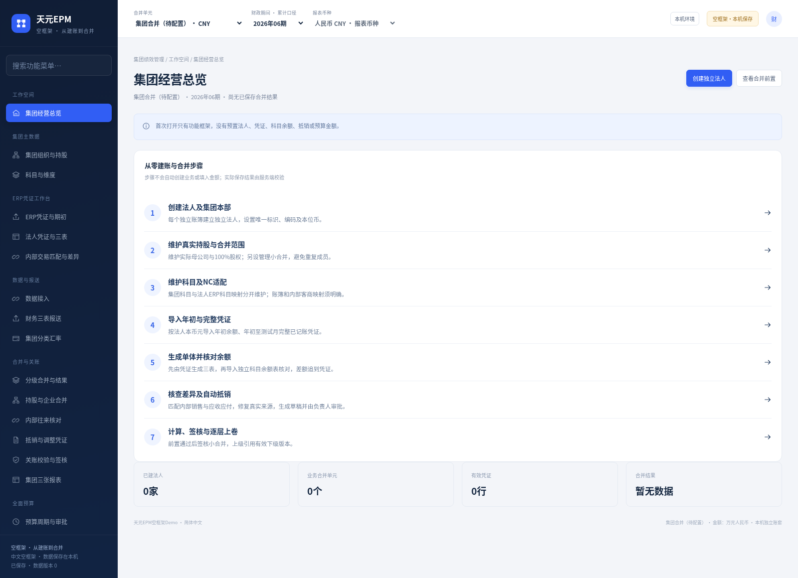
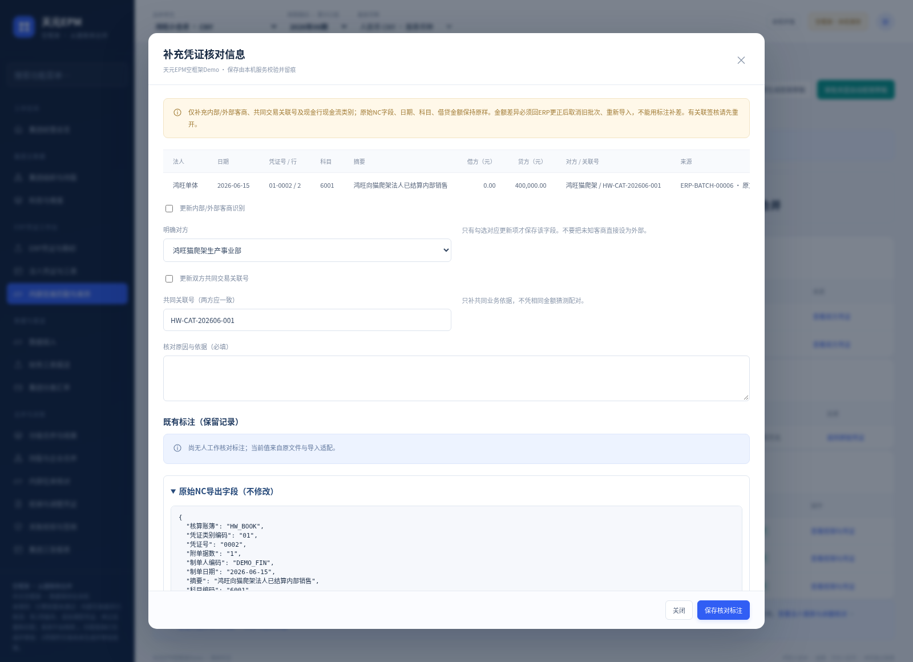

# 杭州天元宠物用品有限公司 · 从零配置与凭证合并版

软件 **FOUNDATION-20261028** · 完整中文文档 **D1.0** · 2026年10月28日。

**[下载新版空框架EXE运行包，约50MB](https://raw.githubusercontent.com/tongtrxtrx-sudo/AI-/c0608919821f47686371476e2a80fbaef5955fa1/foundation-20261028/TianyuanEPM-Foundation-Demo-Windows-x64.zip)** · **[下载31页从零图文指南Word](https://raw.githubusercontent.com/tongtrxtrx-sudo/AI-/c0608919821f47686371476e2a80fbaef5955fa1/foundation-20261028/EPM-Foundation-From-Zero-Guide-CN.docx)** · **[下载完整四册＋专项指南＋模板，约20MB](https://raw.githubusercontent.com/tongtrxtrx-sudo/AI-/c0608919821f47686371476e2a80fbaef5955fa1/foundation-20261028/TianyuanEPM-Foundation-Docs-CN-D1.0.zip)**

完整解压运行ZIP，双击 **天元EPM 从零配置Demo.exe**。适用Windows 10/11 64位；私有运行环境已附带，无需用户安装Python、Docker、WSL或虚拟机，不用邮箱登录。新目录`%LOCALAPPDATA%\TianyuanEPMFoundationDemo`，原版本和数据保留。

首次只有框架：没有法人、持股、科目、期初、凭证、余额报表、抵销、合并结果或预算业务样例。空TY_GROUP只是导航容器，不能空算或签核。你按指南自己建档并导入模板；示例资料独立，不会自动载入。

## 从基础档案到合并

1. 创建集团本部、鸿旺单体、猫爬架法人、电子工厂法人，维护本币及真实天元100%持股。
2. 创建鸿旺三法人的管理小合并；集团成员只选本部和鸿旺子结果，避免再次平铺三家。
3. 维护集团科目、各法人ERP科目映射、NC账簿与内部客商和共同交易号。
4. 导入年初科目余额和年初至测试月完整已记账凭证，生成单体三表。
5. 导入期间科目余额核对表，逐法人核对；该表只核对，不把余额再次记账。
6. 从余额／内部交易差异查原凭证、批次和源行；核实识别信息可以补注，金额错误须回ERP更正、停用旧批重导。
7. 重新生成、核对与匹配，准确项生成自动抵销草稿，负责人审批，计算签核鸿旺。
8. 集团本层扫描，即使0匹配也需当前核对版本；按真实资本及投资维护投资权益草稿并审批，再引用鸿旺计算签核集团。

Foundation正式合并须每个叶子具备当前ERP来源、余额核对、匹配与审批；手工汇总报表和手工销售不能绕过凭证。实际原账核对包含合法损益结转，管理利润表保留本期损益并留下处理依据。

## 图文指南与全模块四册

|文档|Word|PDF|
|---|---|---|
|从零建档到凭证合并，31页／23张实机图|[下载](https://raw.githubusercontent.com/tongtrxtrx-sudo/AI-/c0608919821f47686371476e2a80fbaef5955fa1/foundation-20261028/EPM-Foundation-From-Zero-Guide-CN.docx)|[查看](https://raw.githubusercontent.com/tongtrxtrx-sudo/AI-/c0608919821f47686371476e2a80fbaef5955fa1/foundation-20261028/EPM-Foundation-From-Zero-Guide-CN.pdf)|
|PRD含字段附录，76页|[下载](https://raw.githubusercontent.com/tongtrxtrx-sudo/AI-/c0608919821f47686371476e2a80fbaef5955fa1/foundation-20261028/EPM-Foundation-PRD-CN.docx)|[查看](https://raw.githubusercontent.com/tongtrxtrx-sudo/AI-/c0608919821f47686371476e2a80fbaef5955fa1/foundation-20261028/EPM-Foundation-PRD-CN.pdf)|
|系统研发与交互说明，14页|[下载](https://raw.githubusercontent.com/tongtrxtrx-sudo/AI-/c0608919821f47686371476e2a80fbaef5955fa1/foundation-20261028/EPM-Foundation-System-CN.docx)|[查看](https://raw.githubusercontent.com/tongtrxtrx-sudo/AI-/c0608919821f47686371476e2a80fbaef5955fa1/foundation-20261028/EPM-Foundation-System-CN.pdf)|
|产品说明及案例，16页|[下载](https://raw.githubusercontent.com/tongtrxtrx-sudo/AI-/c0608919821f47686371476e2a80fbaef5955fa1/foundation-20261028/EPM-Foundation-Product-CN.docx)|[查看](https://raw.githubusercontent.com/tongtrxtrx-sudo/AI-/c0608919821f47686371476e2a80fbaef5955fa1/foundation-20261028/EPM-Foundation-Product-CN.pdf)|
|全模块用户手册，18页|[下载](https://raw.githubusercontent.com/tongtrxtrx-sudo/AI-/c0608919821f47686371476e2a80fbaef5955fa1/foundation-20261028/EPM-Foundation-User-Manual-CN.docx)|[查看](https://raw.githubusercontent.com/tongtrxtrx-sudo/AI-/c0608919821f47686371476e2a80fbaef5955fa1/foundation-20261028/EPM-Foundation-User-Manual-CN.pdf)|

四册覆盖24模块，另有专项31页逐步指南，总155页。运行包`docs`也包含这5份Word和5份PDF。`templates`含5类可导入空白／已填Excel、4份基础档案页面准备表、对应CSV及NC配置参照；页面准备表按页面照填，不冒充有Excel导入按钮。NC与通用凭证同一业务二选一。

## 可核对的虚构案例与异常练习

从空创建4法人，维护12集团科目，48映射、8年初、26 NC分录、48余额核对行。业务全部发生2026年6月，示例假设1—5月无发生；真实资料仍须年初至测试月完整提供。

HW向CAT已结销售40，向ELEC未结20及AR/AP20，共3项准确匹配。鸿旺与集团均累计收入840、成本480、费用90、净利270、资产现金470、负债0、资本200、留存270，单位人民币万元。母本部投资200与子期初资本200在集团层抵销，集团资产仍470。

异常文件单独放“异常演示数据”，不能与正常示例叠加导入。余额一分差、内部40／39差异均有真实原行与凭证来源，不自动补差；停用更正后重算，旧签核和原凭证快照不变。

## 验收与边界

[独立验收报告](Foundation空框架独立验收报告.md)记录10组真实HTTP＋2组真实浏览器全链，26张实际截图，另84领域回归通过。Windows原生EXE→包内Windows Python→HTTP/SQLite在Wine兼容环境16项通过；**不能代替目标Windows真机验收**。源码、Word/PDF、模板、运行ZIP与[交付校验](交付版本与校验.json)逐项绑定。

NC当前为CSV/XLSX文件导入，企业在线接口未配置，不写回NC。当前为2026、100%全资全额、CNY/USD普通主体的本机研发Demo，复杂权益／商誉／少数股东／未实现存货利润／生产身份等不冒称已完成。角色切换不是企业生产登录。

结束通过本机环境安全退出；备份前停止服务并复制整个数据目录。旧／未知schema数据库拒绝改写。每次软件升级完整交付四册的约定保留，master不修改，只更新已授权下载分支。公开HTTPS已实际下载38个文件，逐字节、SHA256及真实Office/ZIP结构全部核验通过，见[公开下载验证](public-download-verification.json)。
