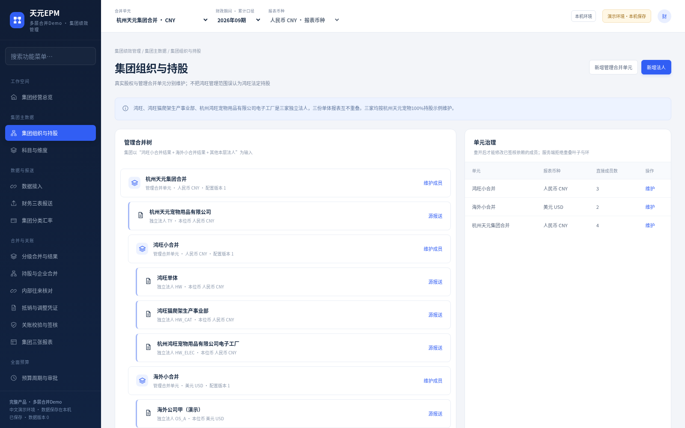
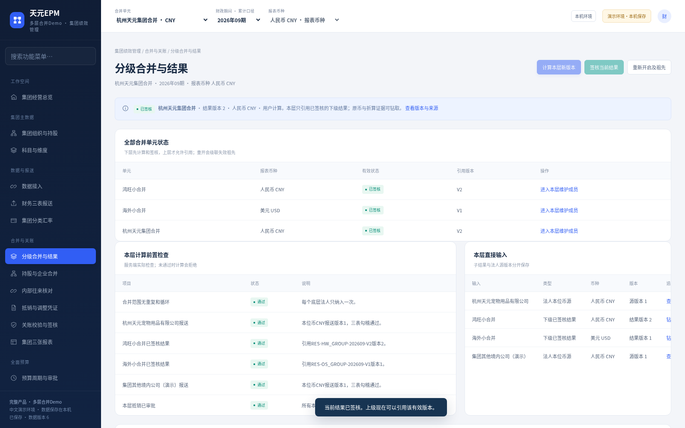
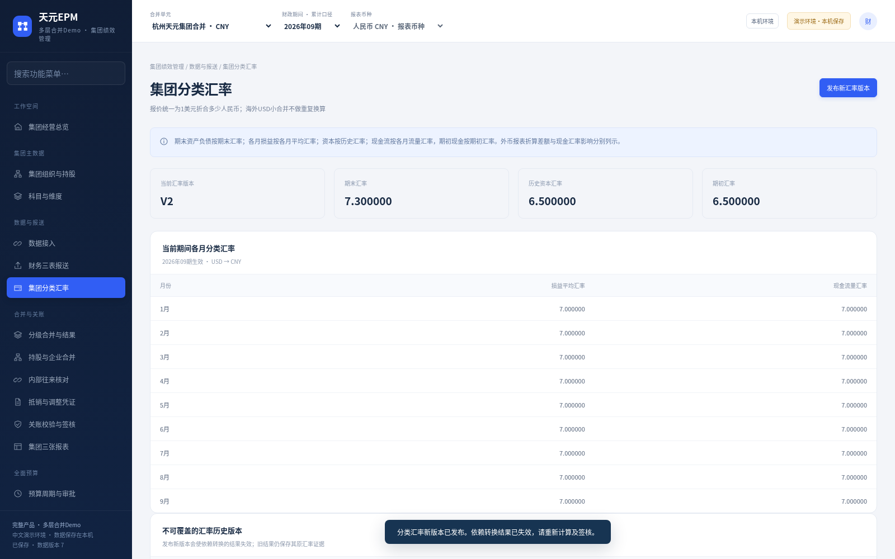
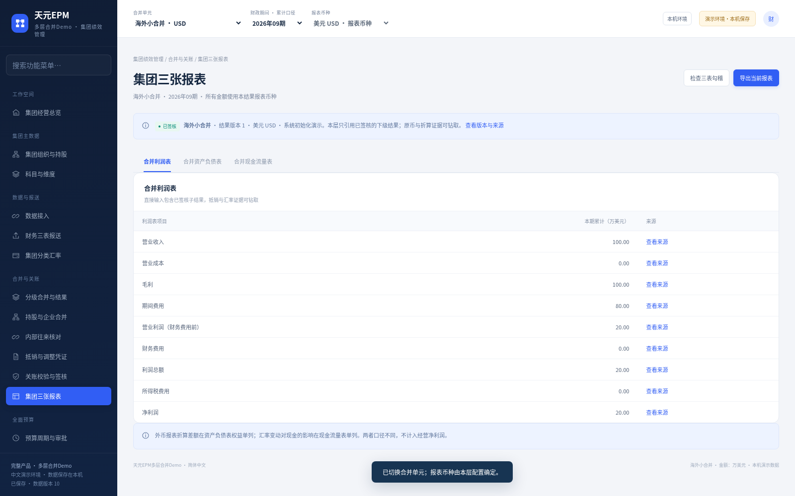

# 天元 EPM 多层合并 Demo · 安装与演示手册

公司：杭州天元宠物用品有限公司  
版本：多层合并与美元报表折算演示版  
适用环境：Windows 10/11 64位；简体中文本机持久化 Demo。验收证据见包内 source/acceptance 及 verification 目录。

## 一、这次交付解决什么问题

本次在独立的新 Demo 中实现“先小合并，再上卷集团”的工作流程。鸿旺单体、鸿旺猫爬架生产事业部、杭州鸿旺宠物用品有限公司电子工厂均按用户确认的独立法人处理，三份报表互不包含。三家先形成人民币鸿旺小合并结果，再进入杭州天元集团合并。

海外各法人用美元报送，先完成美元小合并，再按报表项目所需汇率折算成人民币进入集团。资产负债的期末汇率、损益的期间平均汇率、资本的历史汇率和现金期初汇率分别维护，折算差额与现金汇率变动影响分别列示。

主公司和两家法人名称来自用户；其他演示法人、人员、交易、金额及汇率均为虚构样例。系统用于产品体验及研发验证，不能将演示数字作为正式财务报账或监管申报资料。

## 二、安装、启动及旧环境保护

1. 下载新版 Windows ZIP，完整解压至可读写目录。
2. 双击“天元EPM 多层合并Demo.exe”，浏览器会自动打开本机中文工作台。
3. 保留程序旁的全部文件夹。运行包已经附带解释器，用户无需安装 Python、Docker、WSL 或虚拟机，首次不需要下载额外环境。
4. 本机服务自动选择空闲端口，使用 EXE 打开新环境，不沿用旧平台 `18480` 地址。

新版本默认数据目录为 `%LOCALAPPDATA%\TianyuanEPMGroupDemo`。此前两个目录 `TianyuanEPMDemo`、`SelfDevelopedEPM` 不会被新版覆盖，也不会自动迁入。只重新解压程序不等于备份或重置数据库。

关闭浏览器不会停止服务。演示结束点击右上角“本机环境”→“安全退出”→“确认安全退出”。再次双击相同 EXE 会读取已保存的数据和结果版本。页面无需邮箱或谷歌账号；EXE只为本机建立演示会话。

## 三、法人、管理合并范围与股权关系

|对象|对象类型|本位币或报表币|作用|
|---|---|---|---|
|鸿旺单体|独立法人|人民币|报送自身源数据|
|鸿旺猫爬架生产事业部|独立法人|人民币|报送自身源数据，不因名称带“事业部”而被当作已包含的内部部门|
|杭州鸿旺宠物用品有限公司电子工厂|独立法人|人民币|报送自身源数据|
|鸿旺小合并|虚拟管理合并单元|人民币|接收上述三家，完成本层抵销与签核|
|海外各法人|独立法人|美元|报送美元源数据|
|海外小合并|虚拟管理合并单元|美元|生成已签核美元合并结果|
|杭州天元集团合并|上级合并单元|人民币|接收小合并结果和其他法人，完成上层抵销|

管理合并树不等同实际工商持股树。用户提供的杭州天元100%持股口径应记录在真实股权关系中，不能仅因为三家被纳入鸿旺管理范围，就编造鸿旺直接持有另外两家的股权。

配置入口：“集团组织与持股”→“维护成员”，勾选本层直接接收的“独立法人”或“下级合并单元”，保存单元及成员。单元标识须以大写英文字母开头，可含数字、下划线和短横线；本层报表币种为人民币或美元。新增单元后需先计算并签核，父级才能引用。调整已经签核的成员，应先重开受影响单元及祖先；修改结果不会自动补算已签核报告。

如将原先直接并入集团的“其他公司”改为一个新小合并：先建立包含该法人的新小合并，计算并签核，再重开集团，将原单体成员取消勾选，同时勾选新小合并，保存后重算集团。中间独立配置可以暂存，但同一最终合并树内不能出现两条路径重复包含同一法人。

上层已经引用鸿旺小合并结果时，不再重复加入这三家单体。海外结果也以唯一子结果版本进入集团，不能在上层再次把它当作美元单体重复折算。

## 四、先识别初始化、预览和正式结果

全新数据目录的2026年09期已经使用同一套计算与审批逻辑生成鸿旺、海外、集团三个“系统初始化演示”已签核结果，方便直接体验。它们是实际保存的虚构演示版本；不是企业实际报表。其他期间如果尚未计算，界面会明确显示预览或待计算。预览不能代替正式结果。

完整的上卷必须先得到下级有效签核结果，集团明确引用相应结果 ID、期间和版本。结果历史保留；改变相关源数据、成员、抵销或汇率后，当前有效状态应按依赖更新，不能沿用旧签核直接发布新金额。

## 五、推荐演示顺序

演示初始统一采用2026年09期。左上“合并单元”切换鸿旺、海外或集团；期间按累计口径显示。报表币种随单元固定，国内金额单位人民币万元，海外原币金额单位万美元。

1. 进入“集团组织与持股”查看管理树，再进入“持股与企业合并”查看实际天元100%持股示例，两张树互相独立。
2. 左上选“鸿旺小合并”，进入“分级合并与结果”，点击“重新开启及祖先”，填写原因并“确认重开并保留历史”。鸿旺及集团变为失效，海外美元结果保持有效。
3. 切到集团查看“本层计算前置检查”，尝试“计算本层新版本”，缺少有效鸿旺签核时会被服务端拒绝。再切回鸿旺。
4. 进入“财务三表报送”，在鸿旺猫爬架法人行点击“编辑三表”。在“演示平衡变更助手”选择“本月新增现金销售收入”，金额10，点击“填入平衡变更”，核对实际字段后点击“校验并保存三表源”。助手只填入表单，保存才真正生效。
5. 回“分级合并与结果”点击“计算本层新版本”→“签核当前结果”→“确认签核”。鸿旺收入由1400变为1410。
6. 左上选“杭州天元集团合并”，同样计算并签核。集团收入由2650变为2660、净利润由770变为780，原签核快照继续保留。
7. 点击“查看完整结果与钻取”或“查看版本与来源”，可点“钻取下级结果”“源版本追溯”，查看本层/继承抵销、原币与折算证据，或“导出此结果完整证据”。
8. 安全退出整个服务，再次双击EXE，检查修改后的源数据、合并配置、预算及结果版本仍保留。

上述改数演示会保存。要对照下一章原始金样，可使用尚未改数的新数据目录；不要删除原数据文件。正式演示前先备份已有目录。

## 六、境内收入金样

|步骤|计算|预期收入|
|---|---|---:|
|鸿旺三家单体合计|1000＋300＋200|1500|
|鸿旺小合并|1500－本层内部销售抵销100|1400|
|集团境内部分|鸿旺1400＋其他公司600－上层跨范围抵销50|1950|
|集团最终收入|境内1950＋海外美元收入100按平均率7.0折算700|2650|

在相同源范围和抵销口径下，境内平铺计算也应为 `1000＋300＋200＋600－100－50＝1950`。下层100只继承一次，上层只追加50。示例根级投资资本抵销与业务收入抵销分开保留依据，不能由管理范围自动推导虚构投资。

本例收入金样应与完整三表勾稽一同查看，不能只验收入就认为资产负债及现金流已经通过。

## 七、海外三表与分类汇率金样

海外两个演示法人合计如下：期初现金和资本各100万美元；本期现金收入100、费用80、借款80；期末现金及资产200、负债80、资本100、本期利润20万美元。示例无税、无分红、不考虑少数股东，属于普通非高通胀全资演示。

报价方向统一为“1美元等于多少人民币”：期初6.5、资本历史6.5、本期发生及平均7.0、期末7.2。

|人民币报表项目|计算|预期值|
|---|---|---:|
|收入|100×7.0|700|
|费用|80×7.0|560|
|净利润|20×7.0|140|
|期末资产及现金|200×7.2|1440|
|负债|80×7.2|576|
|资本|100×6.5|650|
|留存收益中的本期利润|20×7.0|140|
|外币报表折算差额|1440－576－650－140|74|

资产负债勾稽：`1440＝576＋650＋140＋74`。

现金流勾稽：`期初650＋经营140＋筹资560＋现金汇率变动影响90＝期末1440`。

折算差额74属于权益/其他综合收益来源；现金汇率变动影响90是现金流量表项目，不能混用。两者也不能作为普通净利润补差。

只修改期末汇率7.2→7.3，平均、历史、期初不变：人民币利润仍140，期末资产及现金1460、负债584、折算差额86、现金汇率变动影响110。若利润随期末汇率变化，则没有正确区分汇率类型。

## 八、结果版本、签核和依赖

每次正式计算产生新结果版本，上级引用已批准且仍有效的下级结果。上级需要同时保存源报送、成员、抵销、会计规则和汇率版本的来源信息。

当某个鸿旺法人的报送发生变化，鸿旺当前结果及依赖它的集团结果应提示过期或需要重算；海外不相关的美元结果应继续保留。仅修改美元兑人民币的折算率，应影响实际依赖该折算率的结果。

已经签核的相关链需要负责人按界面提示重新开启，才允许修改源数据。历史结果仍保留原金额，重新计算不能覆盖或伪装为原签核版本。旧版本可追溯与新版本有效性是两个不同状态。

汇率演示：保持集团为当前单元，进入“集团分类汇率”→“发布新汇率版本”，只将“期末汇率”7.2改成7.3，其他输入不动，再点击弹窗内“发布新汇率版本”。集团结果失效，海外美元签核仍有效。进入“分级合并与结果”，按提示重开、计算新版本、签核。查看完整结果中的“分类汇率及原币转换证据”，确认海外折算利润140不变、CTA86、现金汇率影响110；历史原结果仍是74和90。

初始集团三表金样为：收入2650，净利润770，资产2370，负债576，天元本部资本950，留存收益770，CTA74；`2370＝576＋950＋770＋74`。如果先做了上章新增收入10，集团收入/利润会分别为2660/780，海外折算敏感性仍为140/86/110。

## 九、配置错误应该怎样被拒绝

|错误尝试|预期行为|
|---|---|
|集团已含鸿旺小合并，又加入其中一家单体|拒绝重复叶子纳入，不写入错误成员配置|
|把集团设成鸿旺小合并的下级|拒绝合并树循环|
|把同一内部交易来源编号再次加入|拒绝重复抵销来源，或按明确幂等规则不再重复扣减|
|把鸿旺与其他集团公司的交易放到鸿旺层抵销|拒绝错误层，交易应在包含双方的最低共同合并层处理|
|缺少必要期末、平均、历史或期初率|阻止形成正式折算结果，不静默使用1或任意默认值|
|审计只读角色通过接口改数据|服务端拒绝，即使绕过页面按钮也不能写入|
|另一标签已更新数据后用旧revision保存|提示数据版本冲突，重新读取并核对后保存|

抵销入口：“内部往来核对”或“抵销与调整凭证”→“新增分层抵销草稿”。填写唯一交易编号、双方、正确最低共同层、凭证币种和金额，明确发生月份分配；累计金额必须等于逐月分配合计。保存草稿后审批，再逐层重算与签核。累计内部销售抵销不能默认按收入比例平均分摊，否则会造成逐月损益及外币折算错期。需要作废时按界面流程保留记录，不删除历史签核快照。

## 十、输入、导出、数据位置与排错

源报送和CSV的具体模板以新版页面实际下载模板为准。人民币与美元源数据必须保留本位币及法人标识，不能将已经折算的人民币金额再次当美元导入。整批输入校验失败时应零写入，根据行号或中文原因修改后重试。

“财务三表报送”→“下载本期全量源CSV”取得实际源数据样例；表头为“法人编码,期间,数据区,项目编码,金额,月份”。数据区opening/closing为期初/期末资产负债，profit/cashflow为累计损益/现金流，monthlyProfit/monthlyCashflow为逐月发生额。技术键用于精确导入，页面字段均配中文名称。期间示例2026-09；累计区月份留空，月度区必须含1至9月。按法人完整提供，不能只导入变动行，也不能把现金流差额自动填作经营现金流。包含多个法人的文件需要所有受影响签核范围先重开。

结果导出应标明合并单元、期间、报表币种及结果版本。仅导出金额而丢失口径，会影响后续评审和对账。

通过“本机环境”查看当前真实数据目录和保存状态。安全退出后复制整个 `%LOCALAPPDATA%\TianyuanEPMGroupDemo` 文件夹进行备份；服务运行时只复制一个SQLite文件，可能遗漏WAL中的已提交数据。不要通过删除数据库解决普通报错。

私有实例文件包含本机启动凭据，不应发送到公开仓库或聊天。若需排错，先提供中文错误文字和不含凭据的本地日志片段。独立的生产备份恢复、灾难恢复、单位终端安全策略及物理Windows兼容性仍需专项验收。

## 十一、当前演示边界

本轮围绕全资、普通人民币与美元报表、明确源报送及管理合并树实现示例，功能完成及通过结论以实际验收报告为准。正式项目仍需企业真实源数据、会计政策确认、真实工商持股、投资账面核对、复杂权益及股权变动、税项与未实现利润、生产身份认证和组织隔离、ERP接口、容量与审计验收。

投资抵销示例逐项核对子公司实际报送资本及统一资本历史率，并核对母公司投资合计950。抵销中的投资配对明细不是按被投资法人建立的独立原始投资台账；公开维护界面也不支持各法人不同资本历史率、收购差额或商誉。正式研发应补独立投资源台账及完整会计政策，此处不应宣传为已完成的通用生产能力。

本机演示角色切换用于体验工作职责，不等同公司的正式多用户登录与职责分离体系。Word手册中的技术字段与固定示例数字不能代替财务负责人对真实账套的确认。

## 十二、研发结构与页面交互

本次交付在独立本机中文Demo中实现分级合并业务与证据链。前端四个本地JavaScript模块负责导航、表单、预算和多层业务；构建后资源内嵌在HTML，不依赖外部CDN。Windows原生EXE启动包内解释器与本机服务，并打开浏览器；用户无需安装开发环境。

页面通过同源HTTP调用本机服务。每次保存携带数据revision，服务端在事务中校验角色、输入、依赖、余额及当前版本；成功才写入SQLite并返回新状态，失败时整笔不写入。过期revision会提示重新读取，不覆盖另一个窗口刚保存的内容。服务只监听127.0.0.1。

合并计算模块负责管理树去重、最低共同层抵销、逐层已签核快照引用、三表勾稽与分类汇率折算。结果保存源版本、下级结果ID、抵销sourceId和实际汇率版本；结果状态与历史金额分开管理。相关输入变更使当前依赖失效，不能悄悄把旧批准套在新金额上。

包内source/backend/API-CONTRACT.md说明动作与数据字段；source/backend/CALCULATION-CONTRACT.md说明资产负债、损益、现金流、权益历史与计算口径；source/acceptance保留独立HTTP/浏览器验收脚本和对应结果；verification保留Windows原生EXE链路的Wine验证证据。研发可据此重复本例，再在正式项目中扩展生产准则和接口。
